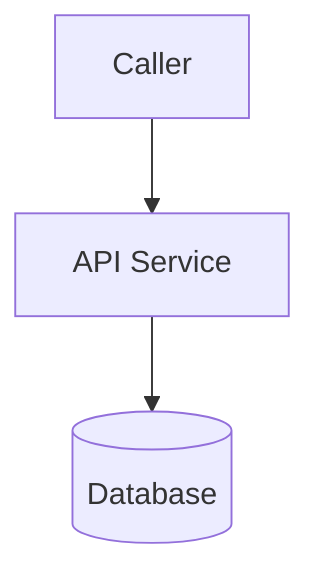

| Property | Value |
| :--- | :--- |
| Endpoints | 15 |
| Base path | `https://platform.nlproducts.net/o` |

## Architecture

## Endpoints

### POST `/analytics-settings-rest/v1.0/configuration/wizard-mode`

[AnalyticsDXPEntityBatchExporter] AnalyticsSettingsRest.v1.0.postConfigurationWizardMode

### GET `/analytics-settings-rest/v1.0/channels`

[Channel] AnalyticsSettingsRest.v1.0.getChannelsPage

### PATCH `/analytics-settings-rest/v1.0/channels`

[Channel] AnalyticsSettingsRest.v1.0.patchChannel

### POST `/analytics-settings-rest/v1.0/channels`

[Channel] AnalyticsSettingsRest.v1.0.postChannel

### GET `/analytics-settings-rest/v1.0/commerce-channels`

[CommerceChannel] AnalyticsSettingsRest.v1.0.getCommerceChannelsPage

### GET `/analytics-settings-rest/v1.0/contacts/account-groups`

[ContactAccountGroup] AnalyticsSettingsRest.v1.0.getContactAccountGroupsPage

### GET `/analytics-settings-rest/v1.0/contacts/configuration`

[ContactConfiguration] AnalyticsSettingsRest.v1.0.getContactConfiguration

### PUT `/analytics-settings-rest/v1.0/contacts/configuration`

[ContactConfiguration] AnalyticsSettingsRest.v1.0.putContactConfiguration

### GET `/analytics-settings-rest/v1.0/contacts/organizations`

[ContactOrganization] AnalyticsSettingsRest.v1.0.getContactOrganizationsPage

### GET `/analytics-settings-rest/v1.0/contacts/user-groups`

[ContactUserGroup] AnalyticsSettingsRest.v1.0.getContactUserGroupsPage

### DELETE `/analytics-settings-rest/v1.0/data-sources`

[DataSource] AnalyticsSettingsRest.v1.0.deleteDataSource

### POST `/analytics-settings-rest/v1.0/data-sources`

[DataSource] AnalyticsSettingsRest.v1.0.postDataSource

### GET `/analytics-settings-rest/v1.0/fields/accounts`

[Field] AnalyticsSettingsRest.v1.0.getFieldsAccountsPage

### PATCH `/analytics-settings-rest/v1.0/fields/accounts`

[Field] AnalyticsSettingsRest.v1.0.patchFieldAccount

### GET `/analytics-settings-rest/v1.0/fields/orders`

[Field] AnalyticsSettingsRest.v1.0.getFieldsOrdersPage
