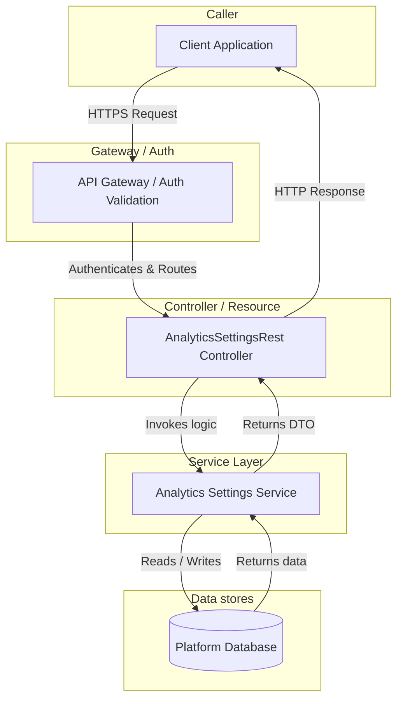

| Property | Value |
| :--- | :--- |
| Deployed as | Global REST API - OpenAPI |
| Endpoints | 15 |
| Base path | `https://platform.nlproducts.net/o` |

:::note
This documentation covers Part 1 of 2 for the `AnalyticsSettingsRest` service. Additional items continue in Part 2.
:::

## Architecture



## Configuration

- Headers: `Authorization: Bearer <token>`, `Content-Type: application/json`
- Auth required: `true` for all endpoints in this service.

## Data

- Schemas: `AnalyticsSettingsRest.v1.0.Channel`, `AnalyticsSettingsRest.v1.0.ContactConfiguration`, `AnalyticsSettingsRest.v1.0.DataSourceToken`

## Endpoints

### POST /analytics-settings-rest/v1.0/configuration/wizard-mode

`[AnalyticsDXPEntityBatchExporter] AnalyticsSettingsRest.v1.0.postConfigurationWizardMode`

#### Parameters

*None*

#### Example Request / Response

**Request**

```json
{
  "wizardMode": true
}
```

**Response**

```json
{
  "status": "success"
}
```

---

### GET /analytics-settings-rest/v1.0/channels

`[Channel] AnalyticsSettingsRest.v1.0.getChannelsPage`

#### Parameters

| Name | Location | Type | Required | Description |
| :--- | :--- | :--- | :--- | :--- |
| `keywords` | query | string | false | Filter channels by keyword |
| `page` | query | string | false | Page number |
| `pageSize` | query | string | false | Number of items per page |
| `sort` | query | string | false | Sorting criteria |

#### Example Request / Response

**Request**

```http
GET /analytics-settings-rest/v1.0/channels?page=1&pageSize=10 HTTP/1.1
Host: platform.nlproducts.net
```

**Response**

```json
{
  "items": [],
  "page": 1,
  "pageSize": 10,
  "totalCount": 0
}
```

---

### PATCH /analytics-settings-rest/v1.0/channels

`[Channel] AnalyticsSettingsRest.v1.0.patchChannel`

#### Parameters

*None*

#### Example Request / Response

**Request**

```json
{
  "name": "Updated Channel Name"
}
```

**Response**

```json
{
  "id": "123",
  "name": "Updated Channel Name"
}
```

---

### POST /analytics-settings-rest/v1.0/channels

`[Channel] AnalyticsSettingsRest.v1.0.postChannel`

#### Parameters

*None*

#### Example Request / Response

**Request**

```json
{
  "name": "New Channel"
}
```

**Response**

```json
{
  "id": "124",
  "name": "New Channel"
}
```

---

### GET /analytics-settings-rest/v1.0/commerce-channels

`[CommerceChannel] AnalyticsSettingsRest.v1.0.getCommerceChannelsPage`

#### Parameters

| Name | Location | Type | Required | Description |
| :--- | :--- | :--- | :--- | :--- |
| `keywords` | query | string | false | Filter commerce channels |
| `page` | query | string | false | Page number |
| `pageSize` | query | string | false | Page size |
| `sort` | query | string | false | Sort order |

#### Example Request / Response

**Request**

```http
GET /analytics-settings-rest/v1.0/commerce-channels HTTP/1.1
Host: platform.nlproducts.net
```

**Response**

```json
{
  "items": [],
  "totalCount": 0
}
```

---

### GET /analytics-settings-rest/v1.0/contacts/account-groups

`[ContactAccountGroup] AnalyticsSettingsRest.v1.0.getContactAccountGroupsPage`

#### Parameters

| Name | Location | Type | Required | Description |
| :--- | :--- | :--- | :--- | :--- |
| `keywords` | query | string | false | Filter keyword |
| `page` | query | string | false | Page number |
| `pageSize` | query | string | false | Page size |
| `sort` | query | string | false | Sort order |

#### Example Request / Response

**Request**

```http
GET /analytics-settings-rest/v1.0/contacts/account-groups HTTP/1.1
Host: platform.nlproducts.net
```

**Response**

```json
{
  "items": [],
  "totalCount": 0
}
```

---

### GET /analytics-settings-rest/v1.0/contacts/configuration

`[ContactConfiguration] AnalyticsSettingsRest.v1.0.getContactConfiguration`

#### Parameters

*None*

#### Example Request / Response

**Request**

```http
GET /analytics-settings-rest/v1.0/contacts/configuration HTTP/1.1
Host: platform.nlproducts.net
```

**Response**

```json
{
  "enabled": true,
  "syncInterval": "hourly"
}
```

---

### PUT /analytics-settings-rest/v1.0/contacts/configuration

`[ContactConfiguration] AnalyticsSettingsRest.v1.0.putContactConfiguration`

#### Parameters

*None*

#### Example Request / Response

**Request**

```json
{
  "enabled": false,
  "syncInterval": "daily"
}
```

**Response**

```json
{
  "status": "updated"
}
```

---

### GET /analytics-settings-rest/v1.0/contacts/organizations

`[ContactOrganization] AnalyticsSettingsRest.v1.0.getContactOrganizationsPage`

#### Parameters

| Name | Location | Type | Required | Description |
| :--- | :--- | :--- | :--- | :--- |
| `keywords` | query | string | false | Filter keyword |
| `page` | query | string | false | Page number |
| `pageSize` | query | string | false | Page size |
| `sort` | query | string | false | Sort order |

#### Example Request / Response

**Request**

```http
GET /analytics-settings-rest/v1.0/contacts/organizations HTTP/1.1
Host: platform.nlproducts.net
```

**Response**

```json
{
  "items": [],
  "totalCount": 0
}
```

---

### GET /analytics-settings-rest/v1.0/contacts/user-groups

`[ContactUserGroup] AnalyticsSettingsRest.v1.0.getContactUserGroupsPage`

#### Parameters

| Name | Location | Type | Required | Description |
| :--- | :--- | :--- | :--- | :--- |
| `keywords` | query | string | false | Filter keyword |
| `page` | query | string | false | Page number |
| `pageSize` | query | string | false | Page size |
| `sort` | query | string | false | Sort order |

#### Example Request / Response

**Request**

```http
GET /analytics-settings-rest/v1.0/contacts/user-groups HTTP/1.1
Host: platform.nlproducts.net
```

**Response**

```json
{
  "items": [],
  "totalCount": 0
}
```

---

### DELETE /analytics-settings-rest/v1.0/data-sources

`[DataSource] AnalyticsSettingsRest.v1.0.deleteDataSource`

#### Parameters

*None*

#### Example Request / Response

**Request**

```http
DELETE /analytics-settings-rest/v1.0/data-sources HTTP/1.1
Host: platform.nlproducts.net
```

**Response**

```json
{
  "status": "deleted"
}
```

---

### POST /analytics-settings-rest/v1.0/data-sources

`[DataSource] AnalyticsSettingsRest.v1.0.postDataSource`

#### Parameters

*None*

#### Example Request / Response

**Request**

```json
{
  "token": "sample-data-source-token"
}
```

**Response**

```json
{
  "status": "created"
}
```

---

### GET /analytics-settings-rest/v1.0/fields/accounts

`[Field] AnalyticsSettingsRest.v1.0.getFieldsAccountsPage`

#### Parameters

| Name | Location | Type | Required | Description |
| :--- | :--- | :--- | :--- | :--- |
| `keyword` | query | string | false | Search keyword |
| `page` | query | string | false | Page number |
| `pageSize` | query | string | false | Page size |
| `sort` | query | string | false | Sort order |

#### Example Request / Response

**Request**

```http
GET /analytics-settings-rest/v1.0/fields/accounts HTTP/1.1
Host: platform.nlproducts.net
```

**Response**

```json
{
  "items": [],
  "totalCount": 0
}
```

---

### PATCH /analytics-settings-rest/v1.0/fields/accounts

`[Field] AnalyticsSettingsRest.v1.0.patchFieldAccount`

#### Parameters

*None*

#### Example Request / Response

**Request**

```json
[
  {
    "fieldName": "accountType",
    "enabled": true
  }
]
```

**Response**

```json
{
  "status": "success"
}
```

---

### GET /analytics-settings-rest/v1.0/fields/orders

`[Field] AnalyticsSettingsRest.v1.0.getFieldsOrdersPage`

#### Parameters

| Name | Location | Type | Required | Description |
| :--- | :--- | :--- | :--- | :--- |
| `keyword` | query | string | false | Search keyword |
| `page` | query | string | false | Page number |
| `pageSize` | query | string | false | Page size |
| `sort` | query | string | false | Sort order |

#### Example Request / Response

**Request**

```http
GET /analytics-settings-rest/v1.0/fields/orders HTTP/1.1
Host: platform.nlproducts.net
```

**Response**

```json
{
  "items": [],
  "totalCount": 0
}
```
