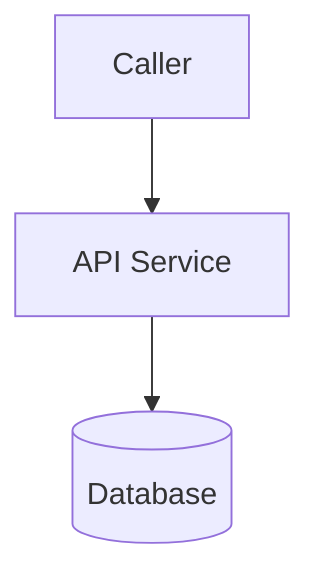

| Property | Value |
| :--- | :--- |
| Endpoints | 9 |
| Base path | `https://platform.nlproducts.net/o` |

## Architecture

## Endpoints

### GET `/batch-planner/v1.0/plans/{internalClassNameKey}/fields`

[Field] BatchPlanner.v1.0.getPlanInternalClassNameKeyFieldsPage

### GET `/batch-planner/v1.0/plans`

[Plan] BatchPlanner.v1.0.getPlansPage

### POST `/batch-planner/v1.0/plans`

[Plan] BatchPlanner.v1.0.postPlan

### GET `/batch-planner/v1.0/plans/{internalClassNameKey}/template`

[Plan] BatchPlanner.v1.0.getPlanTemplate

### DELETE `/batch-planner/v1.0/plans/{planId}`

[Plan] BatchPlanner.v1.0.deletePlan

### GET `/batch-planner/v1.0/plans/{planId}`

[Plan] BatchPlanner.v1.0.getPlan

### PATCH `/batch-planner/v1.0/plans/{planId}`

[Plan] BatchPlanner.v1.0.patchPlan

### GET `/batch-planner/v1.0/plans/{internalClassNameKey}/site-scopes`

[SiteScope] BatchPlanner.v1.0.getPlanInternalClassNameKeySiteScopesPage

### GET `/batch-planner/v1.0/plans/{internalClassNameKey}/strategies`

[Strategy] BatchPlanner.v1.0.getPlanInternalClassNameKeyStrategiesPage
