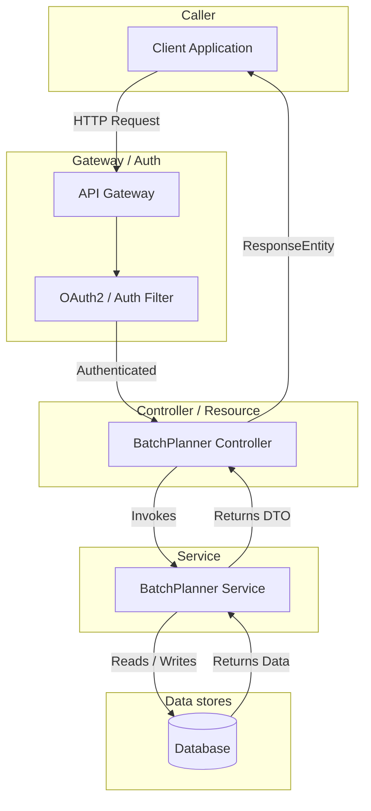

| Property | Value |
| :--- | :--- |
| Deployed as | Global REST API - OpenAPI |
| Endpoints | 9 |
| Base path | `https://platform.nlproducts.net/o` |

## Architecture



## Configuration

- `auth_required`: `true` across all endpoints, requiring valid token authorization.
- `base_path`: `https://platform.nlproducts.net/o`

## Data

- `BatchPlanner.v1.0.PageField`: Schema representing a paginated collection of fields.
- `BatchPlanner.v1.0.PagePlan`: Schema representing a paginated collection of batch plans.
- `BatchPlanner.v1.0.Plan`: Schema representing an individual batch plan object.
- `BatchPlanner.v1.0.PageSiteScope`: Schema representing a paginated collection of site scopes.
- `BatchPlanner.v1.0.PageStrategy`: Schema representing a paginated collection of strategies.

## Endpoints

### GET `/batch-planner/v1.0/plans/{internalClassNameKey}/fields`

`[Field] BatchPlanner.v1.0.getPlanInternalClassNameKeyFieldsPage`

#### Parameters

| Name | Location | Type | Required | Description |
| :--- | :--- | :--- | :--- | :--- |
| `internalClassNameKey` | path | string | Yes | The internal class name key. |
| `export` | query | string | No | Export format option. |

#### Response

`ResponseEntity<BatchPlanner.v1.0.PageField>`

```json
{
  "items": [],
  "page": 1,
  "pageSize": 20,
  "totalCount": 0
}
```

---

### GET /batch-planner/v1.0/plans

`[Plan] BatchPlanner.v1.0.getPlansPage`

#### Parameters

| Name | Location | Type | Required | Description |
| :--- | :--- | :--- | :--- | :--- |
| `page` | query | string | No | Page number for pagination. |
| `pageSize` | query | string | No | Number of items per page. |

#### Response

`ResponseEntity<BatchPlanner.v1.0.PagePlan>`

```json
{
  "items": [],
  "page": 1,
  "pageSize": 20,
  "totalCount": 0
}
```

---

### POST /batch-planner/v1.0/plans

`[Plan] BatchPlanner.v1.0.postPlan`

#### Request Body

`BatchPlanner.v1.0.Plan`

```json
{
  "name": "string",
  "description": "string"
}
```

#### Response

`ResponseEntity<BatchPlanner.v1.0.Plan>`

```json
{
  "id": "string",
  "name": "string",
  "description": "string"
}
```

---

### GET `/batch-planner/v1.0/plans/{internalClassNameKey}/template`

`[Plan] BatchPlanner.v1.0.getPlanTemplate`

#### Parameters

| Name | Location | Type | Required | Description |
| :--- | :--- | :--- | :--- | :--- |
| `internalClassNameKey` | path | string | Yes | The internal class name key. |

#### Response

`ResponseEntity<byte[]>` (`application/octet-stream`)

```json
// Binary file stream response
```

---

### DELETE `/batch-planner/v1.0/plans/{planId}`

`[Plan] BatchPlanner.v1.0.deletePlan`

#### Parameters

| Name | Location | Type | Required | Description |
| :--- | :--- | :--- | :--- | :--- |
| `planId` | path | string | Yes | The unique identifier of the plan. |

#### Response

`ResponseEntity<Void>` (`application/json`, `application/xml`)

```json
{}
```

---

### GET `/batch-planner/v1.0/plans/{planId}`

`[Plan] BatchPlanner.v1.0.getPlan`

#### Parameters

| Name | Location | Type | Required | Description |
| :--- | :--- | :--- | :--- | :--- |
| `planId` | path | string | Yes | The unique identifier of the plan. |

#### Response

`ResponseEntity<BatchPlanner.v1.0.Plan>`

```json
{
  "id": "string",
  "name": "string",
  "description": "string"
}
```

---

### PATCH `/batch-planner/v1.0/plans/{planId}`

`[Plan] BatchPlanner.v1.0.patchPlan`

#### Parameters

| Name | Location | Type | Required | Description |
| :--- | :--- | :--- | :--- | :--- |
| `planId` | path | string | Yes | The unique identifier of the plan. |

#### Request Body

`BatchPlanner.v1.0.Plan`

```json
{
  "name": "string",
  "description": "string"
}
```

#### Response

`ResponseEntity<BatchPlanner.v1.0.Plan>`

```json
{
  "id": "string",
  "name": "string",
  "description": "string"
}
```

---

### GET `/batch-planner/v1.0/plans/{internalClassNameKey}/site-scopes`

`[SiteScope] BatchPlanner.v1.0.getPlanInternalClassNameKeySiteScopesPage`

#### Parameters

| Name | Location | Type | Required | Description |
| :--- | :--- | :--- | :--- | :--- |
| `internalClassNameKey` | path | string | Yes | The internal class name key. |
| `export` | query | string | No | Export format option. |

#### Response

`ResponseEntity<BatchPlanner.v1.0.PageSiteScope>`

```json
{
  "items": [],
  "page": 1,
  "pageSize": 20,
  "totalCount": 0
}
```

---

### GET `/batch-planner/v1.0/plans/{internalClassNameKey}/strategies`

`[Strategy] BatchPlanner.v1.0.getPlanInternalClassNameKeyStrategiesPage`

#### Parameters

| Name | Location | Type | Required | Description |
| :--- | :--- | :--- | :--- | :--- |
| `internalClassNameKey` | path | string | Yes | The internal class name key. |

#### Response

`ResponseEntity<BatchPlanner.v1.0.PageStrategy>`

```json
{
  "items": [],
  "page": 1,
  "pageSize": 20,
  "totalCount": 0
}
```
