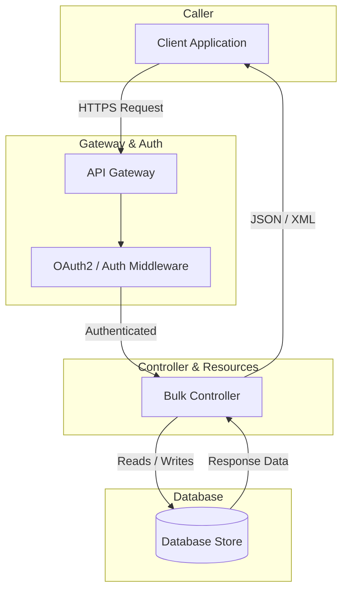

| Property | Value |
| :--- | :--- |
| Deployed as | Global REST API - OpenAPI |
| Endpoints | 8 |
| Base path | `https://platform.nlproducts.net/o` |

## Architecture



## Configuration

- `Base URL`: `https://platform.nlproducts.net/o`
- `Authentication`: Required (`auth_required: true` for all endpoints)
- `Media Types`: `application/json`, `application/xml`

## Data

- `Bulk.v1.0.KeywordBulkSelection`: Schema for keyword bulk operations.
- `Bulk.v1.0.DocumentBulkSelection`: Schema for document and taxonomy bulk selections.
- `Bulk.v1.0.TaxonomyCategoryBulkSelection`: Schema for taxonomy category batch actions.
- `Bulk.v1.0.PageKeyword`: Paginated response schema for keywords.
- `Bulk.v1.0.Selection`: Selection result schema.
- `Bulk.v1.0.Status`: Execution status schema.
- `Bulk.v1.0.PageTaxonomyVocabulary`: Paginated response schema for taxonomy vocabularies.

## Endpoints

### PATCH /bulk/v1.0/keywords/batch

`[Keyword] Bulk.v1.0.patchKeywordBatch`

Performs a partial batch update for keywords using a bulk selection payload.

#### Request Body Schema

`Bulk.v1.0.KeywordBulkSelection`

```json
{
  "itemIds": [101, 102],
  "updateValues": {
    "status": "active"
  }
}
```

#### Response

```json
{
  "status": "success",
  "processedCount": 2
}
```

---

### PUT /bulk/v1.0/keywords/batch

`[Keyword] Bulk.v1.0.putKeywordBatch`

Replaces or updates a batch of keywords based on the provided bulk selection.

#### Request Body Schema

`Bulk.v1.0.KeywordBulkSelection`

```json
{
  "itemIds": [101, 102],
  "replaceValues": {
    "status": "updated"
  }
}
```

#### Response

```json
{
  "status": "success",
  "processedCount": 2
}
```

---

### POST /bulk/v1.0/keywords/common

`[Keyword] Bulk.v1.0.postKeywordsCommonPage`

Retrieves a common page of keywords using document bulk selection criteria.

#### Request Body Schema

`Bulk.v1.0.DocumentBulkSelection`

```json
{
  "query": "search-term",
  "filters": []
}
```

#### Response (`Bulk.v1.0.PageKeyword`)

```json
{
  "items": [],
  "totalCount": 0,
  "page": 1
}
```

---

### POST /bulk/v1.0/bulk-selection

`[Selection] Bulk.v1.0.postBulkSelection`

Creates or processes a bulk selection operation.

#### Request Body Schema

`Bulk.v1.0.DocumentBulkSelection`

```json
{
  "selectionCriteria": "all"
}
```

#### Response (`Bulk.v1.0.Selection`)

```json
{
  "selectionId": "sel_12345",
  "status": "created"
}
```

---

### GET /bulk/v1.0/status

`[Status] Bulk.v1.0.getStatus`

Retrieves the current execution status of ongoing or completed bulk operations.

#### Response (`Bulk.v1.0.Status`)

```json
{
  "state": "COMPLETED",
  "progressPercentage": 100,
  "message": "All items processed successfully."
}
```

---

### PATCH /bulk/v1.0/taxonomy-categories/batch

`[TaxonomyCategory] Bulk.v1.0.patchTaxonomyCategoryBatch`

Performs a partial batch update on taxonomy categories.

#### Request Body Schema

`Bulk.v1.0.TaxonomyCategoryBulkSelection`

```json
{
  "categoryIds": [201, 202],
  "patchData": {
    "visible": true
  }
}
```

#### Response

```json
{
  "status": "success",
  "updatedCategories": 2
}
```

---

### PUT /bulk/v1.0/taxonomy-categories/batch

`[TaxonomyCategory] Bulk.v1.0.putTaxonomyCategoryBatch`

Replaces or updates a batch of taxonomy categories.

#### Request Body Schema

`Bulk.v1.0.TaxonomyCategoryBulkSelection`

```json
{
  "categoryIds": [201, 202],
  "replaceData": {
    "visible": false
  }
}
```

#### Response

```json
{
  "status": "success",
  "updatedCategories": 2
}
```

---

### POST `/bulk/v1.0/sites/{siteId}/taxonomy-vocabularies/common`

`[TaxonomyVocabulary] Bulk.v1.0.postSiteTaxonomyVocabulariesCommonPage`

Retrieves a common page of taxonomy vocabularies for a specific site.

#### Parameters

| Name | Location | Type | Required | Description |
| :--- | :--- | :--- | :--- | :--- |
| `siteId` | path | string | Yes | Unique identifier of the site. |

#### Request Body Schema

`Bulk.v1.0.DocumentBulkSelection`

```json
{
  "scope": "site"
}
```

#### Response (`Bulk.v1.0.PageTaxonomyVocabulary`)

```json
{
  "vocabularies": [],
  "totalCount": 0
}
```
