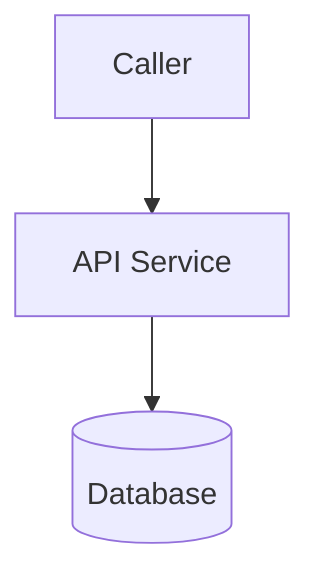

| Property | Value |
| :--- | :--- |
| Endpoints | 8 |
| Base path | `https://platform.nlproducts.net/o` |

## Architecture

## Endpoints

### PATCH `/bulk/v1.0/keywords/batch`

[Keyword] Bulk.v1.0.patchKeywordBatch

### PUT `/bulk/v1.0/keywords/batch`

[Keyword] Bulk.v1.0.putKeywordBatch

### POST `/bulk/v1.0/keywords/common`

[Keyword] Bulk.v1.0.postKeywordsCommonPage

### POST `/bulk/v1.0/bulk-selection`

[Selection] Bulk.v1.0.postBulkSelection

### GET `/bulk/v1.0/status`

[Status] Bulk.v1.0.getStatus

### PATCH `/bulk/v1.0/taxonomy-categories/batch`

[TaxonomyCategory] Bulk.v1.0.patchTaxonomyCategoryBatch

### PUT `/bulk/v1.0/taxonomy-categories/batch`

[TaxonomyCategory] Bulk.v1.0.putTaxonomyCategoryBatch

### POST `/bulk/v1.0/sites/{siteId}/taxonomy-vocabularies/common`

[TaxonomyVocabulary] Bulk.v1.0.postSiteTaxonomyVocabulariesCommonPage
