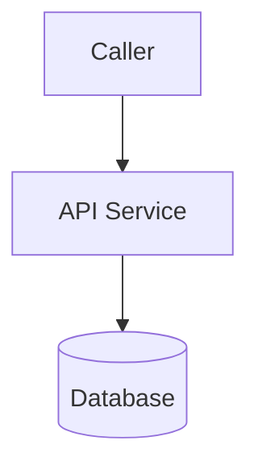

| Property | Value |
| :--- | :--- |
| Endpoints | 2 |
| Base path | `https://platform.nlproducts.net/o` |

## Architecture

## Endpoints

### GET `/captcha/v1.0/captcha/challenge`

[Captcha] Captcha.v1.0.getCaptchaChallenge

### POST `/captcha/v1.0/captcha/response`

[Captcha] Captcha.v1.0.postCaptchaResponse
