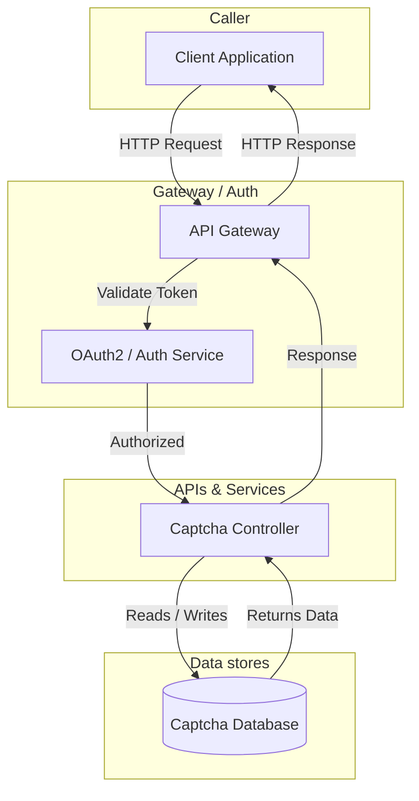

| Property | Value |
| :--- | :--- |
| Deployed as | `Global REST API - OpenAPI` |
| Endpoints | 2 |
| Base path | `https://platform.nlproducts.net/o` |

## Architecture



## Configuration & Data

- Authentication: Bearer token `auth_required: true` for all endpoints.
- Data Schemas:
  - `Captcha.v1.0.Captcha`

## Endpoints

### GET /captcha/v1.0/captcha/challenge

Retrieves a new captcha challenge.

| Parameter | Type | In | Description |
| :--- | :--- | :--- | :--- |
| `Authorization` | string | header | Bearer token for authentication. |

#### Response

```json
{
  "challengeId": "string",
  "question": "string"
}
```

---

### POST /captcha/v1.0/captcha/response

Submits a captcha response for verification.

| Parameter | Type | In | Description |
| :--- | :--- | :--- | :--- |
| `Authorization` | string | header | Bearer token for authentication. |

#### Request Body

```json
{
  "challengeId": "string",
  "answer": "string"
}
```

#### Response

```json
{
  "success": true,
  "message": "Captcha verified successfully"
}
```
