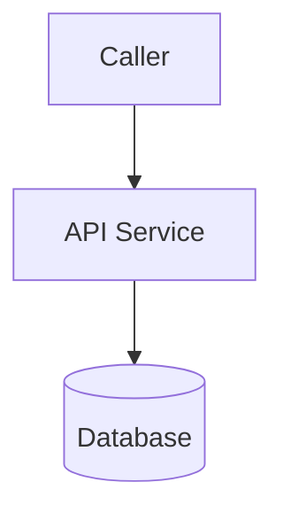

| Property | Value |
| :--- | :--- |
| Endpoints | 15 |
| Base path | `https://platform.nlproducts.net/o` |

## Architecture

## Endpoints

### GET `/change-tracking-rest/v1.0/ct-collections`

[CTCollection] ChangeTrackingRest.v1.0.getCTCollectionsPage

### POST `/change-tracking-rest/v1.0/ct-collections`

[CTCollection] ChangeTrackingRest.v1.0.postCTCollection

### POST `/change-tracking-rest/v1.0/ct-collections/batch`

[CTCollection] ChangeTrackingRest.v1.0.postCTCollectionBatch

### DELETE `/change-tracking-rest/v1.0/ct-collections/by-external-reference-code/{externalReferenceCode}`

[CTCollection] ChangeTrackingRest.v1.0.deleteCTCollectionByExternalReferenceCode

### GET `/change-tracking-rest/v1.0/ct-collections/by-external-reference-code/{externalReferenceCode}`

[CTCollection] ChangeTrackingRest.v1.0.getCTCollectionByExternalReferenceCode

### PATCH `/change-tracking-rest/v1.0/ct-collections/by-external-reference-code/{externalReferenceCode}`

[CTCollection] ChangeTrackingRest.v1.0.patchCTCollectionByExternalReferenceCode

### POST `/change-tracking-rest/v1.0/ct-collections/by-external-reference-code/{externalReferenceCode}/publish`

[CTCollection] ChangeTrackingRest.v1.0.postCTCollectionByExternalReferenceCodePublish

### POST `/change-tracking-rest/v1.0/ct-collections/by-external-reference-code/{externalReferenceCode}/schedule-publish`

[CTCollection] ChangeTrackingRest.v1.0.postCTCollectionByExternalReferenceCodeSchedulePublish

### GET `/change-tracking-rest/v1.0/ct-collections/by-external-reference-code/{externalReferenceCode}/share-link`

[CTCollection] ChangeTrackingRest.v1.0.getCTCollectionByExternalReferenceCodeShareLink

### GET `/change-tracking-rest/v1.0/ct-collections/b{ctCollectionId}/share-link`

[CTCollection] ChangeTrackingRest.v1.0.getCTCollectionShareLink

### POST `/change-tracking-rest/v1.0/ct-collections/export-batch`

[CTCollection] ChangeTrackingRest.v1.0.postCTCollectionsPageExportBatch

### DELETE `/change-tracking-rest/v1.0/ct-collections/{ctCollectionId}`

[CTCollection] ChangeTrackingRest.v1.0.deleteCTCollection

### GET `/change-tracking-rest/v1.0/ct-collections/{ctCollectionId}`

[CTCollection] ChangeTrackingRest.v1.0.getCTCollection

### PATCH `/change-tracking-rest/v1.0/ct-collections/{ctCollectionId}`

[CTCollection] ChangeTrackingRest.v1.0.patchCTCollection

### PUT `/change-tracking-rest/v1.0/ct-collections/{ctCollectionId}`

[CTCollection] ChangeTrackingRest.v1.0.putCTCollection
