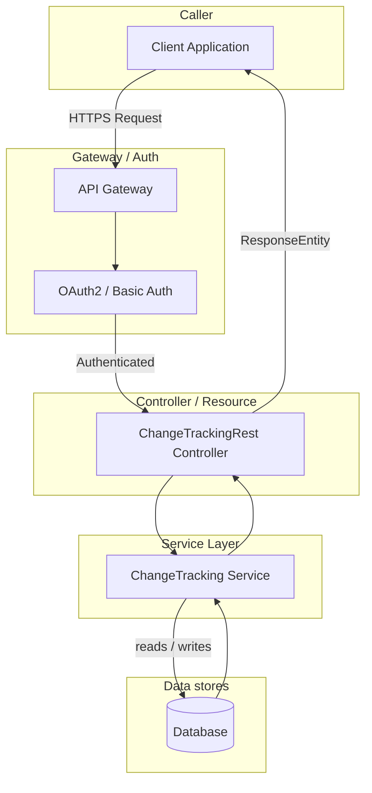

| Property | Value |
| :--- | :--- |
| Deployed as | Global REST API - OpenAPI |
| Endpoints | 15 |
| Base path | `https://platform.nlproducts.net/o` |

:::note
This reference documentation is Part 1 of 3 for the ChangeTrackingRest API. The endpoints documented here represent the initial subset (15 endpoints total in this part). Additional items continue in Part 2.
:::

## Architecture



## Configuration

- Headers: `Authorization: Bearer <token>`, `Content-Type: application/json`
- Secrets: Requires valid platform OAuth2 token or administrative credentials.

## Data

- Schemas: `ChangeTrackingRest.v1.0.CTCollection`, `ChangeTrackingRest.v1.0.PageCTCollection`

## Endpoints

### GET /change-tracking-rest/v1.0/ct-collections

`[CTCollection] ChangeTrackingRest.v1.0.getCTCollectionsPage`

Retrieves a paginated list of change tracking collections.

#### Parameters

| Name | Location | Type | Required | Description |
| :--- | :--- | :--- | :--- | :--- |
| `page` | query | string | No | Page number for pagination |
| `pageSize` | query | string | No | Number of items per page |
| `search` | query | string | No | Search query string |
| `sort` | query | string | No | Sorting criteria |
| `status` | query | string | No | Filter by collection status |

#### Example Response

```json
{
  "items": [
    {
      "id": 101,
      "externalReferenceCode": "ERC-001",
      "name": "Production Release Tracking",
      "status": "active"
    }
  ],
  "page": 1,
  "pageSize": 20,
  "totalCount": 1
}
```

---

### POST /change-tracking-rest/v1.0/ct-collections

`[CTCollection] ChangeTrackingRest.v1.0.postCTCollection`

Creates a new change tracking collection.

#### Request Body Schema

`ChangeTrackingRest.v1.0.CTCollection`

```json
{
  "name": "Hotfix Release Tracking",
  "externalReferenceCode": "ERC-002",
  "status": "pending"
}
```

#### Example Response

```json
{
  "id": 102,
  "externalReferenceCode": "ERC-002",
  "name": "Hotfix Release Tracking",
  "status": "pending"
}
```

---

### POST /change-tracking-rest/v1.0/ct-collections/batch

`[CTCollection] ChangeTrackingRest.v1.0.postCTCollectionBatch`

Performs batch operations for change tracking collections.

#### Parameters

| Name | Location | Type | Required | Description |
| :--- | :--- | :--- | :--- | :--- |
| `callbackURL` | query | string | No | URL to send batch processing results |

#### Request Body Schema

`ChangeTrackingRest.v1.0.CTCollection`

```json
{
  "name": "Batch Collection",
  "externalReferenceCode": "ERC-BATCH-01"
}
```

#### Example Response

```json
{
  "status": "ACCEPTED",
  "message": "Batch processing initiated successfully."
}
```

---

### DELETE `/change-tracking-rest/v1.0/ct-collections/by-external-reference-code/{externalReferenceCode}`

`[CTCollection] ChangeTrackingRest.v1.0.deleteCTCollectionByExternalReferenceCode`

Deletes a change tracking collection by its external reference code.

#### Parameters

| Name | Location | Type | Required | Description |
| :--- | :--- | :--- | :--- | :--- |
| `externalReferenceCode` | path | string | Yes | External reference code of the collection |

#### Example Response

```json
{
  "success": true,
  "message": "Collection deleted successfully."
}
```

---

### GET `/change-tracking-rest/v1.0/ct-collections/by-external-reference-code/{externalReferenceCode}`

`[CTCollection] ChangeTrackingRest.v1.0.getCTCollectionByExternalReferenceCode`

Retrieves a change tracking collection by its external reference code.

#### Parameters

| Name | Location | Type | Required | Description |
| :--- | :--- | :--- | :--- | :--- |
| `externalReferenceCode` | path | string | Yes | External reference code of the collection |

#### Example Response

```json
{
  "id": 101,
  "externalReferenceCode": "ERC-001",
  "name": "Production Release Tracking",
  "status": "active"
}
```

---

### PATCH `/change-tracking-rest/v1.0/ct-collections/by-external-reference-code/{externalReferenceCode}`

`[CTCollection] ChangeTrackingRest.v1.0.patchCTCollectionByExternalReferenceCode`

Partially updates a change tracking collection by its external reference code.

#### Parameters

| Name | Location | Type | Required | Description |
| :--- | :--- | :--- | :--- | :--- |
| `externalReferenceCode` | path | string | Yes | External reference code of the collection |

#### Request Body Schema

`ChangeTrackingRest.v1.0.CTCollection`

```json
{
  "name": "Updated Production Tracking"
}
```

#### Example Response

```json
{
  "id": 101,
  "externalReferenceCode": "ERC-001",
  "name": "Updated Production Tracking",
  "status": "active"
}
```

---

### POST `/change-tracking-rest/v1.0/ct-collections/by-external-reference-code/{externalReferenceCode}/publish`

`[CTCollection] ChangeTrackingRest.v1.0.postCTCollectionByExternalReferenceCodePublish`

Publishes a change tracking collection identified by its external reference code.

#### Parameters

| Name | Location | Type | Required | Description |
| :--- | :--- | :--- | :--- | :--- |
| `externalReferenceCode` | path | string | Yes | External reference code of the collection |

#### Example Response

```json
{
  "success": true,
  "status": "published"
}
```

---

### POST `/change-tracking-rest/v1.0/ct-collections/by-external-reference-code/{externalReferenceCode}/schedule-publish`

`[CTCollection] ChangeTrackingRest.v1.0.postCTCollectionByExternalReferenceCodeSchedulePublish`

Schedules publication for a change tracking collection.

#### Parameters

| Name | Location | Type | Required | Description |
| :--- | :--- | :--- | :--- | :--- |
| `externalReferenceCode` | path | string | Yes | External reference code of the collection |
| `publishDate` | query | string | No | Scheduled publish timestamp |

#### Example Response

```json
{
  "success": true,
  "status": "scheduled",
  "publishDate": "2026-03-01T12:00:00Z"
}
```

---

### GET `/change-tracking-rest/v1.0/ct-collections/by-external-reference-code/{externalReferenceCode}/share-link`

`[CTCollection] ChangeTrackingRest.v1.0.getCTCollectionByExternalReferenceCodeShareLink`

Generates or retrieves a shareable link for a collection by external reference code.

#### Parameters

| Name | Location | Type | Required | Description |
| :--- | :--- | :--- | :--- | :--- |
| `externalReferenceCode` | path | string | Yes | External reference code of the collection |

#### Example Response

```json
"https://platform.nlproducts.net/share/ct/ERC-001"
```

---

### GET `/change-tracking-rest/v1.0/ct-collections/b{ctCollectionId}/share-link`

`[CTCollection] ChangeTrackingRest.v1.0.getCTCollectionShareLink`

Retrieves a shareable link for a collection by its identifier.

#### Parameters

| Name | Location | Type | Required | Description |
| :--- | :--- | :--- | :--- | :--- |
| `ctCollectionId` | path | string | Yes | Unique identifier of the collection |

#### Example Response

```json
"https://platform.nlproducts.net/share/ct/101"
```

---

### POST /change-tracking-rest/v1.0/ct-collections/export-batch

`[CTCollection] ChangeTrackingRest.v1.0.postCTCollectionsPageExportBatch`

Initiates a batch export job for change tracking collections.

#### Parameters

| Name | Location | Type | Required | Description |
| :--- | :--- | :--- | :--- | :--- |
| `search` | query | string | No | Search filter |
| `sort` | query | string | No | Sort filter |
| `status` | query | string | No | Status filter |
| `callbackURL` | query | string | No | Callback endpoint for export completion |
| `contentType` | query | string | No | Target export content type |
| `fieldNames` | query | string | No | Specific fields to include in export |

#### Example Response

```json
{
  "taskId": "export-task-99",
  "status": "queued"
}
```

---

### DELETE `/change-tracking-rest/v1.0/ct-collections/{ctCollectionId}`

`[CTCollection] ChangeTrackingRest.v1.0.deleteCTCollection`

Deletes a change tracking collection by its identifier.

#### Parameters

| Name | Location | Type | Required | Description |
| :--- | :--- | :--- | :--- | :--- |
| `ctCollectionId` | path | string | Yes | Unique identifier of the collection |

#### Example Response

```json
{
  "success": true,
  "message": "Collection deleted successfully."
}
```

---

### GET `/change-tracking-rest/v1.0/ct-collections/{ctCollectionId}`

`[CTCollection] ChangeTrackingRest.v1.0.getCTCollection`

Retrieves a single change tracking collection by its identifier.

#### Parameters

| Name | Location | Type | Required | Description |
| :--- | :--- | :--- | :--- | :--- |
| `ctCollectionId` | path | string | Yes | Unique identifier of the collection |

#### Example Response

```json
{
  "id": 101,
  "externalReferenceCode": "ERC-001",
  "name": "Production Release Tracking",
  "status": "active"
}
```

---

### PATCH `/change-tracking-rest/v1.0/ct-collections/{ctCollectionId}`

`[CTCollection] ChangeTrackingRest.v1.0.patchCTCollection`

Partially updates a change tracking collection by its identifier.

#### Parameters

| Name | Location | Type | Required | Description |
| :--- | :--- | :--- | :--- | :--- |
| `ctCollectionId` | path | string | Yes | Unique identifier of the collection |

#### Request Body Schema

`ChangeTrackingRest.v1.0.CTCollection`

```json
{
  "name": "Patched Collection Name"
}
```

#### Example Response

```json
{
  "id": 101,
  "externalReferenceCode": "ERC-001",
  "name": "Patched Collection Name",
  "status": "active"
}
```

---

### PUT `/change-tracking-rest/v1.0/ct-collections/{ctCollectionId}`

`[CTCollection] ChangeTrackingRest.v1.0.putCTCollection`

Fully updates or replaces a change tracking collection by its identifier.

#### Parameters

| Name | Location | Type | Required | Description |
| :--- | :--- | :--- | :--- | :--- |
| `ctCollectionId` | path | string | Yes | Unique identifier of the collection |

#### Request Body Schema

`ChangeTrackingRest.v1.0.CTCollection`

```json
{
  "name": "Fully Replaced Collection",
  "externalReferenceCode": "ERC-001",
  "status": "active"
}
```

#### Example Response

```json
{
  "id": 101,
  "externalReferenceCode": "ERC-001",
  "name": "Fully Replaced Collection",
  "status": "active"
}
```
