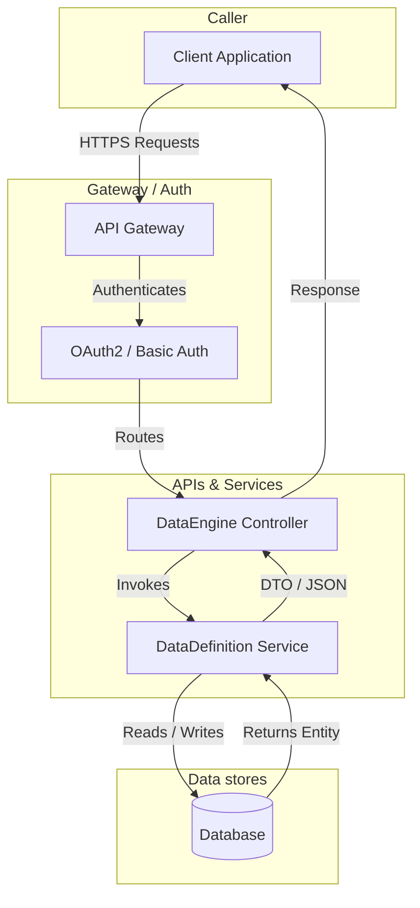

| Property | Value |
| :--- | :--- |
| Deployed as | Global REST API - OpenAPI |
| Endpoints | 15 |
| Base path | `https://platform.nlproducts.net/o` |

:::note
This reference documentation covers Part 1 of 5 for the DataEngine service, detailing the first 15 endpoints. Additional items continue in Part 2.
:::

## Architecture



## Configuration

- Headers: `Authorization: Bearer <token>`, `Content-Type: application/json`
- Secrets: Managed securely via environment-specific vault providers for API gateway keys and token signing.

## Data

- Schemas: `DataEngine.v2.0.DataDefinition`, `DataEngine.v2.0.PageDataDefinition`, `DataEngine.v2.0.PagePermission`

## Endpoints

### DELETE /data-engine/v2.0/data-definitions/batch

`DELETE /data-engine/v2.0/data-definitions/batch`

Deletes a batch of data definitions.

#### Parameters

| Name | Location | Type | Required | Description |
| :--- | :--- | :--- | :--- | :--- |
| `callbackURL` | query | string | No | Optional callback URL for asynchronous processing. |

#### Example Request

```json
{
  "ids": [
    "12345",
    "67890"
  ]
}
```

#### Example Response

```json
{
  "status": "success",
  "message": "Batch deletion initiated."
}
```

---

### PUT /data-engine/v2.0/data-definitions/batch

`PUT /data-engine/v2.0/data-definitions/batch`

Updates a batch of data definitions.

#### Parameters

| Name | Location | Type | Required | Description |
| :--- | :--- | :--- | :--- | :--- |
| `callbackURL` | query | string | No | Optional callback URL for asynchronous processing. |

#### Example Request

```json
[
  {
    "id": "12345",
    "name": "Updated Definition Name"
  }
]
```

#### Example Response

```json
{
  "status": "success",
  "updatedCount": 1
}
```

---

### GET `/data-engine/v2.0/data-definitions/by-content-type/{contentType}`

`GET /data-engine/v2.0/data-definitions/by-content-type/{contentType}`

Retrieves a paginated list of data definitions filtered by content type.

#### Parameters

| Name | Location | Type | Required | Description |
| :--- | :--- | :--- | :--- | :--- |
| `contentType` | path | string | Yes | The content type identifier. |
| `keywords` | query | string | No | Search keywords. |
| `page` | query | string | No | Page number. |
| `pageSize` | query | string | No | Number of items per page. |
| `sort` | query | string | No | Sorting criteria. |

#### Example Response

```json
{
  "items": [
    {
      "id": "12345",
      "name": "Sample Definition"
    }
  ],
  "page": 1,
  "pageSize": 20,
  "totalCount": 1
}
```

---

### POST `/data-engine/v2.0/data-definitions/by-content-type/{contentType}`

`POST /data-engine/v2.0/data-definitions/by-content-type/{contentType}`

Creates a new data definition for a given content type.

#### Parameters

| Name | Location | Type | Required | Description |
| :--- | :--- | :--- | :--- | :--- |
| `contentType` | path | string | Yes | The content type identifier. |

#### Example Request

```json
{
  "name": "New Data Definition",
  "dataDefinitionFields": []
}
```

#### Example Response

```json
{
  "id": "98765",
  "name": "New Data Definition",
  "dataDefinitionFields": []
}
```

---

### GET /data-engine/v2.0/data-definitions/data-definition-fields/field-types

`GET /data-engine/v2.0/data-definitions/data-definition-fields/field-types`

Retrieves available field types for data definitions.

#### Example Response

```json
[
  "text",
  "numeric",
  "boolean",
  "select"
]
```

---

### DELETE `/data-engine/v2.0/data-definitions/{dataDefinitionId}`

`DELETE /data-engine/v2.0/data-definitions/{dataDefinitionId}`

Deletes a specific data definition by ID.

#### Parameters

| Name | Location | Type | Required | Description |
| :--- | :--- | :--- | :--- | :--- |
| `dataDefinitionId` | path | string | Yes | The ID of the data definition. |

#### Example Response

```json
{
  "status": "deleted"
}
```

---

### GET `/data-engine/v2.0/data-definitions/{dataDefinitionId}`

`GET /data-engine/v2.0/data-definitions/{dataDefinitionId}`

Retrieves a specific data definition by ID.

#### Parameters

| Name | Location | Type | Required | Description |
| :--- | :--- | :--- | :--- | :--- |
| `dataDefinitionId` | path | string | Yes | The ID of the data definition. |

#### Example Response

```json
{
  "id": "12345",
  "name": "Detailed Definition",
  "dataDefinitionFields": []
}
```

---

### PATCH `/data-engine/v2.0/data-definitions/{dataDefinitionId}`

`PATCH /data-engine/v2.0/data-definitions/{dataDefinitionId}`

Partially updates a data definition.

#### Parameters

| Name | Location | Type | Required | Description |
| :--- | :--- | :--- | :--- | :--- |
| `dataDefinitionId` | path | string | Yes | The ID of the data definition. |

#### Example Request

```json
{
  "name": "Patched Name"
}
```

#### Example Response

```json
{
  "id": "12345",
  "name": "Patched Name"
}
```

---

### PUT `/data-engine/v2.0/data-definitions/{dataDefinitionId}`

`PUT /data-engine/v2.0/data-definitions/{dataDefinitionId}`

Fully updates or replaces a data definition.

#### Parameters

| Name | Location | Type | Required | Description |
| :--- | :--- | :--- | :--- | :--- |
| `dataDefinitionId` | path | string | Yes | The ID of the data definition. |

#### Example Request

```json
{
  "name": "Replaced Definition",
  "dataDefinitionFields": []
}
```

#### Example Response

```json
{
  "id": "12345",
  "name": "Replaced Definition",
  "dataDefinitionFields": []
}
```

---

### POST `/data-engine/v2.0/data-definitions/{dataDefinitionId}/copy`

`POST /data-engine/v2.0/data-definitions/{dataDefinitionId}/copy`

Copies an existing data definition.

#### Parameters

| Name | Location | Type | Required | Description |
| :--- | :--- | :--- | :--- | :--- |
| `dataDefinitionId` | path | string | Yes | The ID of the data definition to copy. |

#### Example Response

```json
{
  "id": "54321",
  "name": "Copy of Definition",
  "dataDefinitionFields": []
}
```

---

### GET `/data-engine/v2.0/data-definitions/{dataDefinitionId}/permissions`

`GET /data-engine/v2.0/data-definitions/{dataDefinitionId}/permissions`

Retrieves permissions associated with a data definition.

#### Parameters

| Name | Location | Type | Required | Description |
| :--- | :--- | :--- | :--- | :--- |
| `dataDefinitionId` | path | string | Yes | The ID of the data definition. |
| `roleNames` | query | string | No | Filter by role names. |

#### Example Response

```json
{
  "items": [
    {
      "roleName": "Administrator",
      "permissions": ["VIEW", "UPDATE", "DELETE"]
    }
  ]
}
```

---

### PUT `/data-engine/v2.0/data-definitions/{dataDefinitionId}/permissions`

`PUT /data-engine/v2.0/data-definitions/{dataDefinitionId}/permissions`

Updates permissions for a data definition.

#### Parameters

| Name | Location | Type | Required | Description |
| :--- | :--- | :--- | :--- | :--- |
| `dataDefinitionId` | path | string | Yes | The ID of the data definition. |

#### Example Request

```json
[
  {
    "roleName": "Administrator",
    "permissions": ["VIEW", "UPDATE", "DELETE"]
  }
]
```

#### Example Response

```json
{
  "items": [
    {
      "roleName": "Administrator",
      "permissions": ["VIEW", "UPDATE", "DELETE"]
    }
  ]
}
```

---

### GET `/data-engine/v2.0/sites/{siteId}/data-definitions/by-content-type/{contentType}`

`GET /data-engine/v2.0/sites/{siteId}/data-definitions/by-content-type/{contentType}`

Retrieves site-specific data definitions filtered by content type.

#### Parameters

| Name | Location | Type | Required | Description |
| :--- | :--- | :--- | :--- | :--- |
| `siteId` | path | string | Yes | The site identifier. |
| `contentType` | path | string | Yes | The content type identifier. |
| `keywords` | query | string | No | Search keywords. |
| `page` | query | string | No | Page number. |
| `pageSize` | query | string | No | Page size. |
| `sort` | query | string | No | Sorting criteria. |

#### Example Response

```json
{
  "items": [
    {
      "id": "site-def-1",
      "name": "Site Definition"
    }
  ],
  "totalCount": 1
}
```

---

### POST `/data-engine/v2.0/sites/{siteId}/data-definitions/by-content-type/{contentType}`

`POST /data-engine/v2.0/sites/{siteId}/data-definitions/by-content-type/{contentType}`

Creates a site-specific data definition for a given content type.

#### Parameters

| Name | Location | Type | Required | Description |
| :--- | :--- | :--- | :--- | :--- |
| `siteId` | path | string | Yes | The site identifier. |
| `contentType` | path | string | Yes | The content type identifier. |

#### Example Request

```json
{
  "name": "New Site Data Definition"
}
```

#### Example Response

```json
{
  "id": "site-def-2",
  "name": "New Site Data Definition"
}
```

---

### GET `/data-engine/v2.0/sites/{siteId}/data-definitions/by-content-type/{contentType}/by-data-definition-key/{dataDefinitionKey}`

`GET /data-engine/v2.0/sites/{siteId}/data-definitions/by-content-type/{contentType}/by-data-definition-key/{dataDefinitionKey}`

Retrieves a site-specific data definition by its unique key.

#### Parameters

| Name | Location | Type | Required | Description |
| :--- | :--- | :--- | :--- | :--- |
| `siteId` | path | string | Yes | The site identifier. |
| `contentType` | path | string | Yes | The content type identifier. |
| `dataDefinitionKey` | path | string | Yes | The data definition key. |

#### Example Response

```json
{
  "id": "site-def-1",
  "key": "unique-definition-key",
  "name": "Retrieved Site Definition"
}
```
