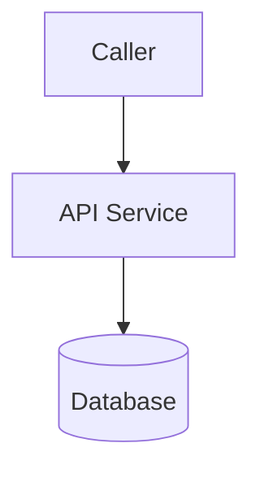

| Property | Value |
| :--- | :--- |
| Endpoints | 15 |
| Base path | `https://platform.nlproducts.net/o` |

## Architecture

## Endpoints

### DELETE `/data-engine/v2.0/data-definitions/batch`

[DataDefinition] DataEngine.v2.0.deleteDataDefinitionBatch

### PUT `/data-engine/v2.0/data-definitions/batch`

[DataDefinition] DataEngine.v2.0.putDataDefinitionBatch

### GET `/data-engine/v2.0/data-definitions/by-content-type/{contentType}`

[DataDefinition] DataEngine.v2.0.getDataDefinitionByContentTypeContentTypePage

### POST `/data-engine/v2.0/data-definitions/by-content-type/{contentType}`

[DataDefinition] DataEngine.v2.0.postDataDefinitionByContentType

### GET `/data-engine/v2.0/data-definitions/data-definition-fields/field-types`

[DataDefinition] DataEngine.v2.0.getDataDefinitionDataDefinitionFieldFieldTypes

### DELETE `/data-engine/v2.0/data-definitions/{dataDefinitionId}`

[DataDefinition] DataEngine.v2.0.deleteDataDefinition

### GET `/data-engine/v2.0/data-definitions/{dataDefinitionId}`

[DataDefinition] DataEngine.v2.0.getDataDefinition

### PATCH `/data-engine/v2.0/data-definitions/{dataDefinitionId}`

[DataDefinition] DataEngine.v2.0.patchDataDefinition

### PUT `/data-engine/v2.0/data-definitions/{dataDefinitionId}`

[DataDefinition] DataEngine.v2.0.putDataDefinition

### POST `/data-engine/v2.0/data-definitions/{dataDefinitionId}/copy`

[DataDefinition] DataEngine.v2.0.postDataDefinitionCopy

### GET `/data-engine/v2.0/data-definitions/{dataDefinitionId}/permissions`

[DataDefinition] DataEngine.v2.0.getDataDefinitionPermissionsPage

### PUT `/data-engine/v2.0/data-definitions/{dataDefinitionId}/permissions`

[DataDefinition] DataEngine.v2.0.putDataDefinitionPermissionsPage

### GET `/data-engine/v2.0/sites/{siteId}/data-definitions/by-content-type/{contentType}`

[DataDefinition] DataEngine.v2.0.getSiteDataDefinitionByContentTypeContentTypePage

### POST `/data-engine/v2.0/sites/{siteId}/data-definitions/by-content-type/{contentType}`

[DataDefinition] DataEngine.v2.0.postSiteDataDefinitionByContentType

### GET `/data-engine/v2.0/sites/{siteId}/data-definitions/by-content-type/{contentType}/by-data-definition-key/{dataDefinitionKey}`

[DataDefinition] DataEngine.v2.0.getSiteDataDefinitionByContentTypeByDataDefinitionKey
