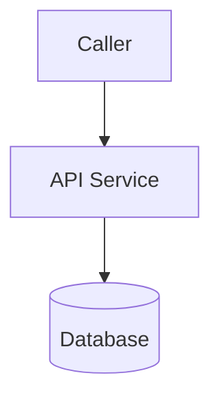

| Property | Value |
| :--- | :--- |
| Endpoints | 6 |
| Base path | `https://platform.nlproducts.net/o` |

## Architecture

## Endpoints

### GET `/digital-signature-rest/v1.0/sites/{siteId}/ds-envelopes`

[DSEnvelope] DigitalSignatureRest.v1.0.getSiteDSEnvelopesPage

### POST `/digital-signature-rest/v1.0/sites/{siteId}/ds-envelopes`

[DSEnvelope] DigitalSignatureRest.v1.0.postSiteDSEnvelope

### POST `/digital-signature-rest/v1.0/sites/{siteId}/ds-envelopes/batch`

[DSEnvelope] DigitalSignatureRest.v1.0.postSiteDSEnvelopeBatch

### POST `/digital-signature-rest/v1.0/sites/{siteId}/ds-envelopes/export-batch`

[DSEnvelope] DigitalSignatureRest.v1.0.postSiteDSEnvelopesPageExportBatch

### GET `/digital-signature-rest/v1.0/sites/{siteId}/ds-envelopes/{dsEnvelopeId}`

[DSEnvelope] DigitalSignatureRest.v1.0.getSiteDSEnvelope

### POST `/digital-signature-rest/v1.0/sites/{siteId}/ds-recipient-view-definition/{dsEnvelopeId}`

[DSRecipientViewDefinition] DigitalSignatureRest.v1.0.postSiteDSRecipientViewDefinition
