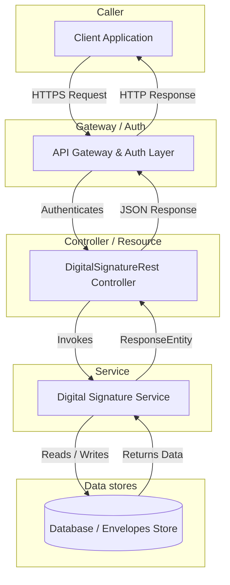

| Property | Value |
| :--- | :--- |
| Deployed as | Global REST API - OpenAPI |
| Endpoints | 6 |
| Base path | `https://platform.nlproducts.net/o` |

## Architecture



## Configuration

- Headers: Standard `Authorization` bearer token or API key required due to `auth_required: true`.
- Secrets: Secure token handling via the platform auth provider.

## Data

- `DigitalSignatureRest.v1.0.DSEnvelope`: Represents a digital signature envelope entity containing metadata, status, and configuration.
- `DigitalSignatureRest.v1.0.PageDSEnvelope`: Paginated collection of digital signature envelopes.
- `DigitalSignatureRest.v1.0.DSRecipientViewDefinition`: Payload definition to generate recipient views.
- `DigitalSignatureRest.v1.0.DSEnvelopeSignatureURL`: Contains signing URL redirection details for recipients.

## Endpoints

### GET `/digital-signature-rest/v1.0/sites/{siteId}/ds-envelopes`

Retrieve a paged list of digital signature envelopes for a specific site.

#### Parameters

| Name | Location | Type | Required | Description |
| :--- | :--- | :--- | :--- | :--- |
| `siteId` | path | string | Yes | The site identifier |
| `fromDate` | query | string | No | Filter envelopes from this date |
| `keywords` | query | string | No | Search keyword filter |
| `order` | query | string | No | Sort order specification |
| `page` | query | string | No | Page number |
| `pageSize` | query | string | No | Number of items per page |
| `status` | query | string | No | Filter by envelope status |

#### Example Response

```json
{
  "items": [
    {
      "id": "env_12345",
      "status": "sent",
      "createdAt": "2023-10-01T12:00:00Z"
    }
  ],
  "page": 1,
  "pageSize": 20,
  "totalCount": 1
}
```

---

### POST `/digital-signature-rest/v1.0/sites/{siteId}/ds-envelopes`

Create a new digital signature envelope for a specific site.

#### Parameters

| Name | Location | Type | Required | Description |
| :--- | :--- | :--- | :--- | :--- |
| `siteId` | path | string | Yes | The site identifier |

#### Request Body Schema

`DigitalSignatureRest.v1.0.DSEnvelope`

```json
{
  "title": "Contract Agreement",
  "status": "draft",
  "recipients": []
}
```

#### Example Response

```json
{
  "id": "env_12345",
  "title": "Contract Agreement",
  "status": "draft",
  "createdAt": "2023-10-01T12:00:00Z"
}
```

---

### POST `/digital-signature-rest/v1.0/sites/{siteId}/ds-envelopes/batch`

Perform batch operations or creation for digital signature envelopes.

#### Parameters

| Name | Location | Type | Required | Description |
| :--- | :--- | :--- | :--- | :--- |
| `siteId` | path | string | Yes | The site identifier |
| `callbackURL` | query | string | No | Webhook callback URL |

#### Request Body Schema

`DigitalSignatureRest.v1.0.DSEnvelope`

```json
{
  "title": "Batch Envelope",
  "status": "pending"
}
```

#### Example Response

```json
{
  "status": "Accepted",
  "batchId": "batch_98765"
}
```

---

### POST `/digital-signature-rest/v1.0/sites/{siteId}/ds-envelopes/export-batch`

Export a batch of digital signature envelopes matching specified filters.

#### Parameters

| Name | Location | Type | Required | Description |
| :--- | :--- | :--- | :--- | :--- |
| `siteId` | path | string | Yes | The site identifier |
| `fromDate` | query | string | No | Filter from date |
| `keywords` | query | string | No | Keyword filters |
| `order` | query | string | No | Sort order |
| `status` | query | string | No | Envelope status |
| `callbackURL` | query | string | No | Notification callback URL |
| `contentType` | query | string | No | Export content type |
| `fieldNames` | query | string | No | Comma-separated field names to export |

#### Example Response

```json
{
  "exportJobId": "job_45678",
  "status": "processing"
}
```

---

### GET `/digital-signature-rest/v1.0/sites/{siteId}/ds-envelopes/{dsEnvelopeId}`

Retrieve details for a specific digital signature envelope.

#### Parameters

| Name | Location | Type | Required | Description |
| :--- | :--- | :--- | :--- | :--- |
| `siteId` | path | string | Yes | The site identifier |
| `dsEnvelopeId` | path | string | Yes | The digital signature envelope identifier |

#### Example Response

```json
{
  "id": "env_12345",
  "title": "Contract Agreement",
  "status": "completed",
  "createdAt": "2023-10-01T12:00:00Z"
}
```

---

### POST `/digital-signature-rest/v1.0/sites/{siteId}/ds-recipient-view-definition/{dsEnvelopeId}`

Generate a recipient view definition and signing URL for an envelope.

#### Parameters

| Name | Location | Type | Required | Description |
| :--- | :--- | :--- | :--- | :--- |
| `siteId` | path | string | Yes | The site identifier |
| `dsEnvelopeId` | path | string | Yes | The digital signature envelope identifier |

#### Request Body Schema

`DigitalSignatureRest.v1.0.DSRecipientViewDefinition`

```json
{
  "userName": "John Doe",
  "email": "john.doe@example.com",
  "returnUrl": "https://example.com/return"
}
```

#### Example Response

```json
{
  "url": "https://demo.docusign.net/Member/PowerFormSigning.aspx?PowerFormId=..."
}
```
