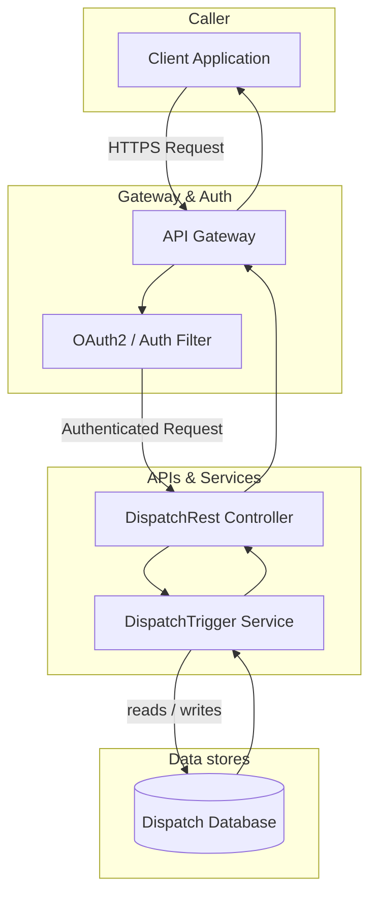

| Property | Value |
| :--- | :--- |
| Deployed as | Global REST API |
| Endpoints | 5 |
| Base path | `https://platform.nlproducts.net/o` |

## Architecture



## Configuration

- Authentication: Required (`auth_required: true` for all endpoints) via token-based authorization headers.
- Base URL: `https://platform.nlproducts.net/o`

## Data

- Request/Response Schemas: `DispatchRest.v1.0.DispatchTrigger`, `DispatchRest.v1.0.PageDispatchTrigger`

## Endpoints

### GET /dispatch-rest/v1.0/dispatch-triggers

Retrieve a page of dispatch triggers.

| Parameter | Location | Type | Required | Description |
| :--- | :--- | :--- | :--- | :--- |
| None | - | - | - | - |

**Response (200 OK)**

```json
{
  "items": [],
  "lastPage": 1,
  "page": 1,
  "pageSize": 20,
  "totalCount": 0
}
```

---

### POST /dispatch-rest/v1.0/dispatch-triggers

Create a new dispatch trigger.

| Parameter | Location | Type | Required | Description |
| :--- | :--- | :--- | :--- | :--- |
| None | - | - | - | - |

**Request Body**

```json
{
  "name": "string",
  "description": "string"
}
```

**Response (200 OK)**

```json
{
  "id": "string",
  "name": "string",
  "description": "string"
}
```

---

### POST /dispatch-rest/v1.0/dispatch-triggers/batch

Process dispatch triggers in batch.

| Parameter | Location | Type | Required | Description |
| :--- | :--- | :--- | :--- | :--- |
| `callbackURL` | query | string | No | Optional callback URL for batch processing |

**Request Body**

```json
{
  "items": []
}
```

**Response (200 OK)**

```json
{
  "status": "ACCEPTED"
}
```

---

### POST /dispatch-rest/v1.0/dispatch-triggers/export-batch

Export dispatch triggers in batch.

| Parameter | Location | Type | Required | Description |
| :--- | :--- | :--- | :--- | :--- |
| `callbackURL` | query | string | No | Optional callback URL |
| `contentType` | query | string | No | Content type for export |
| `fieldNames` | query | string | No | Specific fields to export |

**Response (200 OK)**

```json
{
  "status": "EXPORT_INITIATED"
}
```

---

### POST `/dispatch-rest/v1.0/dispatch-triggers/{dispatchTriggerId}/run`

Run a specific dispatch trigger by its identifier.

| Parameter | Location | Type | Required | Description |
| :--- | :--- | :--- | :--- | :--- |
| `dispatchTriggerId` | path | string | Yes | Unique identifier of the dispatch trigger |

**Response (200 OK)**

```json
{
  "success": true,
  "message": "Dispatch trigger executed successfully."
}
```
