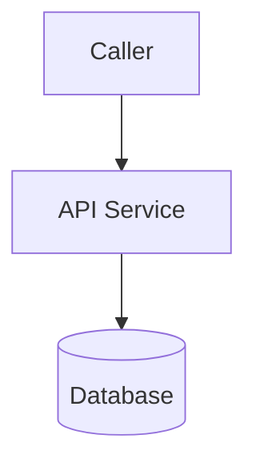

| Property | Value |
| :--- | :--- |
| Endpoints | 5 |
| Base path | `https://platform.nlproducts.net/o` |

## Architecture

## Endpoints

### GET `/dispatch-rest/v1.0/dispatch-triggers`

[DispatchTrigger] DispatchRest.v1.0.getDispatchTriggersPage

### POST `/dispatch-rest/v1.0/dispatch-triggers`

[DispatchTrigger] DispatchRest.v1.0.postDispatchTrigger

### POST `/dispatch-rest/v1.0/dispatch-triggers/batch`

[DispatchTrigger] DispatchRest.v1.0.postDispatchTriggerBatch

### POST `/dispatch-rest/v1.0/dispatch-triggers/export-batch`

[DispatchTrigger] DispatchRest.v1.0.postDispatchTriggersPageExportBatch

### POST `/dispatch-rest/v1.0/dispatch-triggers/{dispatchTriggerId}/run`

[DispatchTrigger] DispatchRest.v1.0.postDispatchTriggerRun
