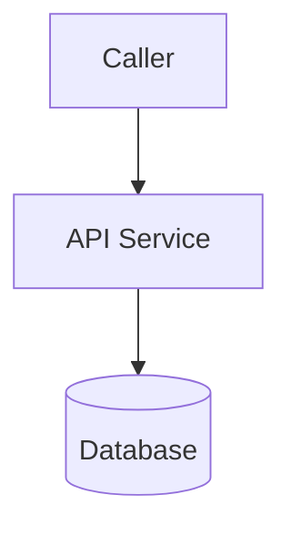

| Property | Value |
| :--- | :--- |
| Endpoints | 15 |
| Base path | `https://platform.nlproducts.net/o` |

## Architecture

## Endpoints

### DELETE `/govcon-client-rest/v1.0/clients/{clientId}`

[Client] GovconClientRest.v1.0.deleteProvisionedClient

### PUT `/govcon-client-rest/v1.0/clients/{clientId}/status`

[Client] GovconClientRest.v1.0.updateClientStatus

### POST `/govcon-client-rest/v1.0/companies/{companyId}/client-extensions/provision`

[ClientExtension] GovconClientRest.v1.0.postCompanyClientExtensionsProvision

### GET `/govcon-client-rest/v1.0/companies/{companyId}/client-extensions/verification`

[ClientExtension] GovconClientRest.v1.0.getCompanyClientExtensionsVerification

### POST `/govcon-client-rest/v1.0/clients/{clientId}/identity/provision`

[ClientIdentity] GovconClientRest.v1.0.postClientIdentityProvision

### GET `/govcon-client-rest/v1.0/client-profiles`

[ClientProfile] GovconClientRest.v1.0.getClientProfiles

### GET `/govcon-client-rest/v1.0/client-profiles/{clientUEI}`

[ClientProfile] GovconClientRest.v1.0.getClientProfileByUEI

### PUT `/govcon-client-rest/v1.0/client/company-banner/{id}/group/{groupId}`

[ClientProfile] GovconClientRest.v1.0.putClientCompanyBannerDetails

### GET `/govcon-client-rest/v1.0/client/company-banner/{uei}`

[ClientProfile] GovconClientRest.v1.0.getClientCompanyBannerDetails

### GET `/govcon-client-rest/v1.0/client/company-legal-info/{uei}`

[ClientProfile] GovconClientRest.v1.0.getCompanyLegalInfoDetails

### GET `/govcon-client-rest/v1.0/client/company-profile/{uei}`

[ClientProfile] GovconClientRest.v1.0.getClientCompanyProfileDetails

### GET `/govcon-client-rest/v1.0/getClientUEI/{groupId}`

[ClientProfile] GovconClientRest.v1.0.getClientUEI

### POST `/govcon-client-rest/v1.0/client-profiles`

[ClientProfileRequest] GovconClientRest.v1.0.postClientProfile

### PATCH `/govcon-client-rest/v1.0/client/company-legal-info/{groupId}/{objectId}`

[CompanyLegalInfo] GovconClientRest.v1.0.patchCompanyLegalInfoDetails

### PATCH `/govcon-client-rest/v1.0/client/company-portfolio/{groupId}/{objectId}`

[CompanyPortfolio] GovconClientRest.v1.0.patchCompanyPortfolio
