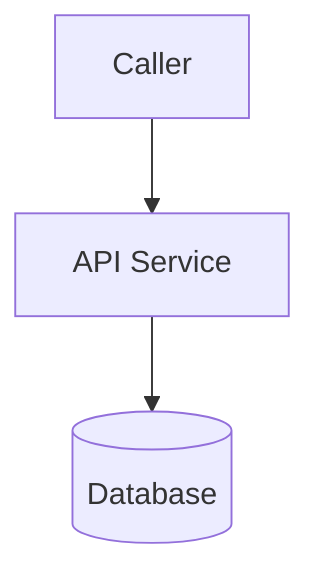

| Property | Value |
| :--- | :--- |
| Endpoints | 15 |
| Base path | `https://platform.nlproducts.net/o` |

## Architecture

## Endpoints

### GET `/headless-admin-address/v1.0/countries`

[Country] HeadlessAdminAddress.v1.0.getCountriesPage

### POST `/headless-admin-address/v1.0/countries`

[Country] HeadlessAdminAddress.v1.0.postCountry

### DELETE `/headless-admin-address/v1.0/countries/batch`

[Country] HeadlessAdminAddress.v1.0.deleteCountryBatch

### POST `/headless-admin-address/v1.0/countries/batch`

[Country] HeadlessAdminAddress.v1.0.postCountryBatch

### PUT `/headless-admin-address/v1.0/countries/batch`

[Country] HeadlessAdminAddress.v1.0.putCountryBatch

### GET `/headless-admin-address/v1.0/countries/by-a2/{a2}`

[Country] HeadlessAdminAddress.v1.0.getCountryByA2

### GET `/headless-admin-address/v1.0/countries/by-a3/{a3}`

[Country] HeadlessAdminAddress.v1.0.getCountryByA3

### GET `/headless-admin-address/v1.0/countries/by-name/{name}`

[Country] HeadlessAdminAddress.v1.0.getCountryByName

### GET `/headless-admin-address/v1.0/countries/by-number/{number}`

[Country] HeadlessAdminAddress.v1.0.getCountryByNumber

### POST `/headless-admin-address/v1.0/countries/export-batch`

[Country] HeadlessAdminAddress.v1.0.postCountriesPageExportBatch

### DELETE `/headless-admin-address/v1.0/countries/{countryId}`

[Country] HeadlessAdminAddress.v1.0.deleteCountry

### GET `/headless-admin-address/v1.0/countries/{countryId}`

[Country] HeadlessAdminAddress.v1.0.getCountry

### PATCH `/headless-admin-address/v1.0/countries/{countryId}`

[Country] HeadlessAdminAddress.v1.0.patchCountry

### PUT `/headless-admin-address/v1.0/countries/{countryId}`

[Country] HeadlessAdminAddress.v1.0.putCountry

### GET `/headless-admin-address/v1.0/countries/{countryId}/regions`

[Region] HeadlessAdminAddress.v1.0.getCountryRegionsPage
