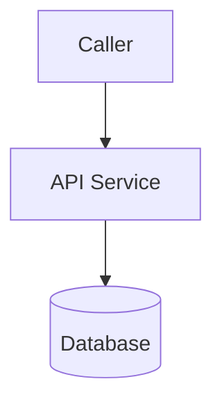

| Property | Value |
| :--- | :--- |
| Endpoints | 8 |
| Base path | `https://platform.nlproducts.net/o` |

## Architecture

## Endpoints

### GET `/headless-admin-content/v1.0/sites/{siteId}/display-page-templates`

[DisplayPageTemplate] HeadlessAdminContent.v1.0.getSiteDisplayPageTemplatesPage

### GET `/headless-admin-content/v1.0/sites/{siteId}/display-page-templates/{displayPageTemplateKey}`

[DisplayPageTemplate] HeadlessAdminContent.v1.0.getSiteDisplayPageTemplate

### POST `/headless-admin-content/v1.0/sites/{siteId}/page-definitions/preview`

[PageDefinition] HeadlessAdminContent.v1.0.postSitePageDefinitionPreview

### GET `/headless-admin-content/v1.0/sites/{siteId}/structured-contents`

[StructuredContent] HeadlessAdminContent.v1.0.getSiteStructuredContentsPage

### POST `/headless-admin-content/v1.0/sites/{siteId}/structured-contents/draft`

[StructuredContent] HeadlessAdminContent.v1.0.postSiteStructuredContentDraft

### DELETE `/headless-admin-content/v1.0/structured-contents/{structuredContentId}/by-version/{version}`

[StructuredContent] HeadlessAdminContent.v1.0.deleteStructuredContentByVersion

### GET `/headless-admin-content/v1.0/structured-contents/{structuredContentId}/by-version/{version}`

[StructuredContent] HeadlessAdminContent.v1.0.getStructuredContentByVersion

### GET `/headless-admin-content/v1.0/structured-contents/{structuredContentId}/versions`

[StructuredContent] HeadlessAdminContent.v1.0.getStructuredContentsVersionsPage
