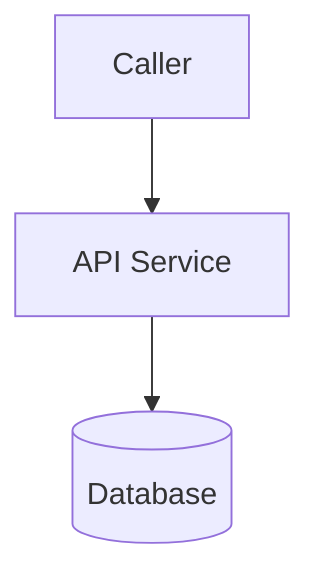

| Property | Value |
| :--- | :--- |
| Endpoints | 15 |
| Base path | `https://platform.nlproducts.net/o` |

## Architecture

## Endpoints

### GET `/headless-admin-list-type/v1.0/list-type-definitions`

[ListTypeDefinition] HeadlessAdminListType.v1.0.getListTypeDefinitionsPage

### POST `/headless-admin-list-type/v1.0/list-type-definitions`

[ListTypeDefinition] HeadlessAdminListType.v1.0.postListTypeDefinition

### DELETE `/headless-admin-list-type/v1.0/list-type-definitions/batch`

[ListTypeDefinition] HeadlessAdminListType.v1.0.deleteListTypeDefinitionBatch

### POST `/headless-admin-list-type/v1.0/list-type-definitions/batch`

[ListTypeDefinition] HeadlessAdminListType.v1.0.postListTypeDefinitionBatch

### PUT `/headless-admin-list-type/v1.0/list-type-definitions/batch`

[ListTypeDefinition] HeadlessAdminListType.v1.0.putListTypeDefinitionBatch

### GET `/headless-admin-list-type/v1.0/list-type-definitions/by-external-reference-code/{externalReferenceCode}`

[ListTypeDefinition] HeadlessAdminListType.v1.0.getListTypeDefinitionByExternalReferenceCode

### PUT `/headless-admin-list-type/v1.0/list-type-definitions/by-external-reference-code/{externalReferenceCode}`

[ListTypeDefinition] HeadlessAdminListType.v1.0.putListTypeDefinitionByExternalReferenceCode

### POST `/headless-admin-list-type/v1.0/list-type-definitions/export-batch`

[ListTypeDefinition] HeadlessAdminListType.v1.0.postListTypeDefinitionsPageExportBatch

### DELETE `/headless-admin-list-type/v1.0/list-type-definitions/{listTypeDefinitionId}`

[ListTypeDefinition] HeadlessAdminListType.v1.0.deleteListTypeDefinition

### GET `/headless-admin-list-type/v1.0/list-type-definitions/{listTypeDefinitionId}`

[ListTypeDefinition] HeadlessAdminListType.v1.0.getListTypeDefinition

### PATCH `/headless-admin-list-type/v1.0/list-type-definitions/{listTypeDefinitionId}`

[ListTypeDefinition] HeadlessAdminListType.v1.0.patchListTypeDefinition

### PUT `/headless-admin-list-type/v1.0/list-type-definitions/{listTypeDefinitionId}`

[ListTypeDefinition] HeadlessAdminListType.v1.0.putListTypeDefinition

### GET `/headless-admin-list-type/v1.0/list-type-definitions/by-external-reference-code/{externalReferenceCode}/list-type-entries`

[ListTypeEntry] HeadlessAdminListType.v1.0.getListTypeDefinitionByExternalReferenceCodeListTypeEntriesPage

### POST `/headless-admin-list-type/v1.0/list-type-definitions/by-external-reference-code/{externalReferenceCode}/list-type-entries`

[ListTypeEntry] HeadlessAdminListType.v1.0.postListTypeDefinitionByExternalReferenceCodeListTypeEntry

### GET `/headless-admin-list-type/v1.0/list-type-definitions/{listTypeDefinitionId}/list-type-entries`

[ListTypeEntry] HeadlessAdminListType.v1.0.getListTypeDefinitionListTypeEntriesPage
