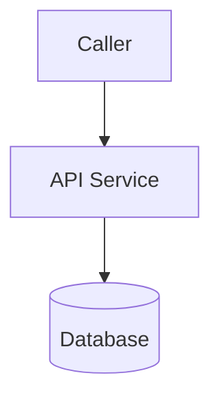

| Property | Value |
| :--- | :--- |
| Endpoints | 15 |
| Base path | `https://platform.nlproducts.net/o` |

## Architecture

## Endpoints

### GET `/headless-admin-site/v1.0/sites/{siteExternalReferenceCode}/display-page-template-folders/{displayPageTemplateFolderExternalReferenceCode}/display-page-templates`

[DisplayPageTemplate] HeadlessAdminSite.v1.0.getSiteSiteByExternalReferenceCodeDisplayPageTemplateFolderDisplayPageTemplatesPage

### POST `/headless-admin-site/v1.0/sites/{siteExternalReferenceCode}/display-page-template-folders/{displayPageTemplateFolderExternalReferenceCode}/display-page-templates`

[DisplayPageTemplate] HeadlessAdminSite.v1.0.postSiteSiteByExternalReferenceCodeDisplayPageTemplateFolderDisplayPageTemplate

### GET `/headless-admin-site/v1.0/sites/{siteExternalReferenceCode}/display-page-templates`

[DisplayPageTemplate] HeadlessAdminSite.v1.0.getSiteSiteByExternalReferenceCodeDisplayPageTemplatesPage

### POST `/headless-admin-site/v1.0/sites/{siteExternalReferenceCode}/display-page-templates`

[DisplayPageTemplate] HeadlessAdminSite.v1.0.postSiteSiteByExternalReferenceCodeDisplayPageTemplate

### GET `/headless-admin-site/v1.0/sites/{siteExternalReferenceCode}/display-page-templates/permissions`

[DisplayPageTemplate] HeadlessAdminSite.v1.0.getSiteSiteByExternalReferenceCodeDisplayPageTemplatePermissionsPage

### PUT `/headless-admin-site/v1.0/sites/{siteExternalReferenceCode}/display-page-templates/permissions`

[DisplayPageTemplate] HeadlessAdminSite.v1.0.putSiteSiteByExternalReferenceCodeDisplayPageTemplatePermissionsPage

### DELETE `/headless-admin-site/v1.0/sites/{siteExternalReferenceCode}/display-page-templates/{displayPageTemplateExternalReferenceCode}`

[DisplayPageTemplate] HeadlessAdminSite.v1.0.deleteSiteSiteByExternalReferenceCodeDisplayPageTemplate

### GET `/headless-admin-site/v1.0/sites/{siteExternalReferenceCode}/display-page-templates/{displayPageTemplateExternalReferenceCode}`

[DisplayPageTemplate] HeadlessAdminSite.v1.0.getSiteSiteByExternalReferenceCodeDisplayPageTemplate

### PATCH `/headless-admin-site/v1.0/sites/{siteExternalReferenceCode}/display-page-templates/{displayPageTemplateExternalReferenceCode}`

[DisplayPageTemplate] HeadlessAdminSite.v1.0.patchSiteSiteByExternalReferenceCodeDisplayPageTemplate

### PUT `/headless-admin-site/v1.0/sites/{siteExternalReferenceCode}/display-page-templates/{displayPageTemplateExternalReferenceCode}`

[DisplayPageTemplate] HeadlessAdminSite.v1.0.putSiteSiteByExternalReferenceCodeDisplayPageTemplate

### POST `/headless-admin-site/v1.0/sites/{siteExternalReferenceCode}/display-page-templates/{displayPageTemplateExternalReferenceCode}/page-specifications`

[DisplayPageTemplate] HeadlessAdminSite.v1.0.postSiteSiteByExternalReferenceCodeDisplayPageTemplatePageSpecification

### GET `/headless-admin-site/v1.0/sites/{siteExternalReferenceCode}/display-page-templates/{displayPageTemplateExternalReferenceCode}/permissions`

[DisplayPageTemplate] HeadlessAdminSite.v1.0.getSiteSiteExternalReferenceCodeDisplayPageTemplatePermissionsPage

### PUT `/headless-admin-site/v1.0/sites/{siteExternalReferenceCode}/display-page-templates/{displayPageTemplateExternalReferenceCode}/permissions`

[DisplayPageTemplate] HeadlessAdminSite.v1.0.putSiteSiteExternalReferenceCodeDisplayPageTemplatePermissionsPage

### GET `/headless-admin-site/v1.0/sites/{siteExternalReferenceCode}/display-page-template-folders`

[DisplayPageTemplateFolder] HeadlessAdminSite.v1.0.getSiteSiteByExternalReferenceCodeDisplayPageTemplateFoldersPage

### POST `/headless-admin-site/v1.0/sites/{siteExternalReferenceCode}/display-page-template-folders`

[DisplayPageTemplateFolder] HeadlessAdminSite.v1.0.postSiteSiteByExternalReferenceCodeDisplayPageTemplateFolder
