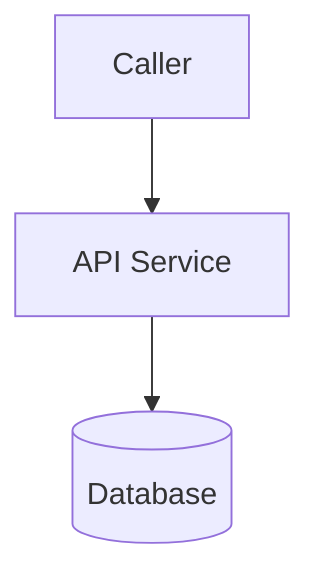

| Property | Value |
| :--- | :--- |
| Endpoints | 15 |
| Base path | `https://platform.nlproducts.net/o` |

## Architecture

## Endpoints

### GET `/headless-admin-taxonomy/v1.0/asset-libraries/{assetLibraryId}/keywords`

[Keyword] HeadlessAdminTaxonomy.v1.0.getAssetLibraryKeywordsPage

### POST `/headless-admin-taxonomy/v1.0/asset-libraries/{assetLibraryId}/keywords`

[Keyword] HeadlessAdminTaxonomy.v1.0.postAssetLibraryKeyword

### POST `/headless-admin-taxonomy/v1.0/asset-libraries/{assetLibraryId}/keywords/batch`

[Keyword] HeadlessAdminTaxonomy.v1.0.postAssetLibraryKeywordBatch

### DELETE `/headless-admin-taxonomy/v1.0/asset-libraries/{assetLibraryId}/keywords/by-external-reference-code/{externalReferenceCode}`

[Keyword] HeadlessAdminTaxonomy.v1.0.deleteAssetLibraryKeywordByExternalReferenceCode

### GET `/headless-admin-taxonomy/v1.0/asset-libraries/{assetLibraryId}/keywords/by-external-reference-code/{externalReferenceCode}`

[Keyword] HeadlessAdminTaxonomy.v1.0.getAssetLibraryKeywordByExternalReferenceCode

### PUT `/headless-admin-taxonomy/v1.0/asset-libraries/{assetLibraryId}/keywords/by-external-reference-code/{externalReferenceCode}`

[Keyword] HeadlessAdminTaxonomy.v1.0.putAssetLibraryKeywordByExternalReferenceCode

### POST `/headless-admin-taxonomy/v1.0/asset-libraries/{assetLibraryId}/keywords/export-batch`

[Keyword] HeadlessAdminTaxonomy.v1.0.postAssetLibraryKeywordsPageExportBatch

### GET `/headless-admin-taxonomy/v1.0/asset-libraries/{assetLibraryId}/keywords/permissions`

[Keyword] HeadlessAdminTaxonomy.v1.0.getAssetLibraryKeywordPermissionsPage

### PUT `/headless-admin-taxonomy/v1.0/asset-libraries/{assetLibraryId}/keywords/permissions`

[Keyword] HeadlessAdminTaxonomy.v1.0.putAssetLibraryKeywordPermissionsPage

### DELETE `/headless-admin-taxonomy/v1.0/keywords/batch`

[Keyword] HeadlessAdminTaxonomy.v1.0.deleteKeywordBatch

### PUT `/headless-admin-taxonomy/v1.0/keywords/batch`

[Keyword] HeadlessAdminTaxonomy.v1.0.putKeywordBatch

### GET `/headless-admin-taxonomy/v1.0/keywords/ranked`

[Keyword] HeadlessAdminTaxonomy.v1.0.getKeywordsRankedPage

### DELETE `/headless-admin-taxonomy/v1.0/keywords/{keywordId}`

[Keyword] HeadlessAdminTaxonomy.v1.0.deleteKeyword

### GET `/headless-admin-taxonomy/v1.0/keywords/{keywordId}`

[Keyword] HeadlessAdminTaxonomy.v1.0.getKeyword

### PUT `/headless-admin-taxonomy/v1.0/keywords/{keywordId}`

[Keyword] HeadlessAdminTaxonomy.v1.0.putKeyword
