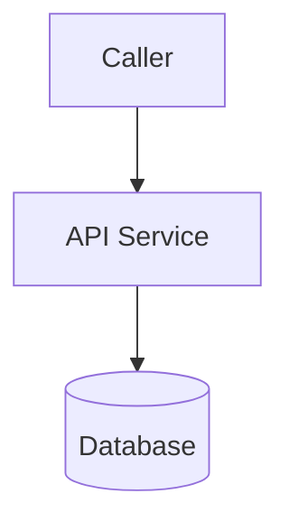

| Property | Value |
| :--- | :--- |
| Endpoints | 15 |
| Base path | `https://platform.nlproducts.net/o` |

## Architecture

## Endpoints

### GET `/headless-admin-user/v1.0/account-groups/by-external-reference-code/{accountGroupExternalReferenceCode}/accounts`

[Account] HeadlessAdminUser.v1.0.getAccountGroupByExternalReferenceCodeAccountsPage

### GET `/headless-admin-user/v1.0/account-groups/{accountGroupId}/accounts`

[Account] HeadlessAdminUser.v1.0.getAccountGroupAccountsPage

### POST `/headless-admin-user/v1.0/account-groups/{accountGroupId}/accounts/export-batch`

[Account] HeadlessAdminUser.v1.0.postAccountGroupAccountsPageExportBatch

### GET `/headless-admin-user/v1.0/accounts`

[Account] HeadlessAdminUser.v1.0.getAccountsPage

### POST `/headless-admin-user/v1.0/accounts`

[Account] HeadlessAdminUser.v1.0.postAccount

### DELETE `/headless-admin-user/v1.0/accounts/batch`

[Account] HeadlessAdminUser.v1.0.deleteAccountBatch

### POST `/headless-admin-user/v1.0/accounts/batch`

[Account] HeadlessAdminUser.v1.0.postAccountBatch

### PUT `/headless-admin-user/v1.0/accounts/batch`

[Account] HeadlessAdminUser.v1.0.putAccountBatch

### DELETE `/headless-admin-user/v1.0/accounts/by-external-reference-code/{externalReferenceCode}`

[Account] HeadlessAdminUser.v1.0.deleteAccountByExternalReferenceCode

### GET `/headless-admin-user/v1.0/accounts/by-external-reference-code/{externalReferenceCode}`

[Account] HeadlessAdminUser.v1.0.getAccountByExternalReferenceCode

### PATCH `/headless-admin-user/v1.0/accounts/by-external-reference-code/{externalReferenceCode}`

[Account] HeadlessAdminUser.v1.0.patchAccountByExternalReferenceCode

### PUT `/headless-admin-user/v1.0/accounts/by-external-reference-code/{externalReferenceCode}`

[Account] HeadlessAdminUser.v1.0.putAccountByExternalReferenceCode

### POST `/headless-admin-user/v1.0/accounts/export-batch`

[Account] HeadlessAdminUser.v1.0.postAccountsPageExportBatch

### DELETE `/headless-admin-user/v1.0/accounts/{accountId}`

[Account] HeadlessAdminUser.v1.0.deleteAccount

### GET `/headless-admin-user/v1.0/accounts/{accountId}`

[Account] HeadlessAdminUser.v1.0.getAccount
