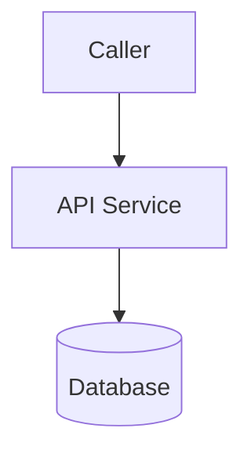

| Property | Value |
| :--- | :--- |
| Endpoints | 15 |
| Base path | `https://platform.nlproducts.net/o` |

## Architecture

## Endpoints

### GET `/headless-admin-workflow/v1.0/workflow-tasks/{workflowTaskId}/assignable-users`

[Assignee] HeadlessAdminWorkflow.v1.0.getWorkflowTaskAssignableUsersPage

### GET `/headless-admin-workflow/v1.0/workflow-instances/{workflowInstanceId}/next-transitions`

[Transition] HeadlessAdminWorkflow.v1.0.getWorkflowInstanceNextTransitionsPage

### GET `/headless-admin-workflow/v1.0/workflow-tasks/{workflowTaskId}/next-transitions`

[Transition] HeadlessAdminWorkflow.v1.0.getWorkflowTaskNextTransitionsPage

### GET `/headless-admin-workflow/v1.0/workflow-definitions`

[WorkflowDefinition] HeadlessAdminWorkflow.v1.0.getWorkflowDefinitionsPage

### POST `/headless-admin-workflow/v1.0/workflow-definitions`

[WorkflowDefinition] HeadlessAdminWorkflow.v1.0.postWorkflowDefinition

### DELETE `/headless-admin-workflow/v1.0/workflow-definitions/batch`

[WorkflowDefinition] HeadlessAdminWorkflow.v1.0.deleteWorkflowDefinitionBatch

### POST `/headless-admin-workflow/v1.0/workflow-definitions/batch`

[WorkflowDefinition] HeadlessAdminWorkflow.v1.0.postWorkflowDefinitionBatch

### PUT `/headless-admin-workflow/v1.0/workflow-definitions/batch`

[WorkflowDefinition] HeadlessAdminWorkflow.v1.0.putWorkflowDefinitionBatch

### GET `/headless-admin-workflow/v1.0/workflow-definitions/by-name/{name}`

[WorkflowDefinition] HeadlessAdminWorkflow.v1.0.getWorkflowDefinitionByName

### POST `/headless-admin-workflow/v1.0/workflow-definitions/deploy`

[WorkflowDefinition] HeadlessAdminWorkflow.v1.0.postWorkflowDefinitionDeploy

### POST `/headless-admin-workflow/v1.0/workflow-definitions/export-batch`

[WorkflowDefinition] HeadlessAdminWorkflow.v1.0.postWorkflowDefinitionsPageExportBatch

### POST `/headless-admin-workflow/v1.0/workflow-definitions/save`

[WorkflowDefinition] HeadlessAdminWorkflow.v1.0.postWorkflowDefinitionSave

### DELETE `/headless-admin-workflow/v1.0/workflow-definitions/undeploy`

[WorkflowDefinition] HeadlessAdminWorkflow.v1.0.deleteWorkflowDefinitionUndeploy

### POST `/headless-admin-workflow/v1.0/workflow-definitions/update-active`

[WorkflowDefinition] HeadlessAdminWorkflow.v1.0.postWorkflowDefinitionUpdateActive

### DELETE `/headless-admin-workflow/v1.0/workflow-definitions/{workflowDefinitionId}`

[WorkflowDefinition] HeadlessAdminWorkflow.v1.0.deleteWorkflowDefinition
