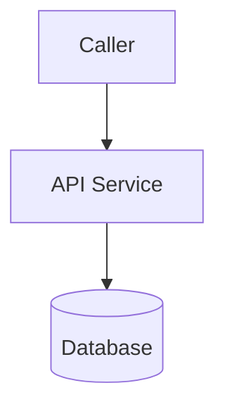

| Property | Value |
| :--- | :--- |
| Endpoints | 14 |
| Base path | `https://platform.nlproducts.net/o` |

## Architecture

## Endpoints

### GET `/headless-batch-engine/v1.0/export-task/by-external-reference-code/{externalReferenceCode}`

[ExportTask] HeadlessBatchEngine.v1.0.getExportTaskByExternalReferenceCode

### GET `/headless-batch-engine/v1.0/export-task/by-external-reference-code/{externalReferenceCode}/content`

[ExportTask] HeadlessBatchEngine.v1.0.getExportTaskByExternalReferenceCodeContent

### POST `/headless-batch-engine/v1.0/export-task/{className}/{contentType}`

[ExportTask] HeadlessBatchEngine.v1.0.postExportTask

### GET `/headless-batch-engine/v1.0/export-task/{exportTaskId}`

[ExportTask] HeadlessBatchEngine.v1.0.getExportTask

### GET `/headless-batch-engine/v1.0/export-task/{exportTaskId}/content`

[ExportTask] HeadlessBatchEngine.v1.0.getExportTaskContent

### GET `/headless-batch-engine/v1.0/import-task/by-external-reference-code/{externalReferenceCode}`

[ImportTask] HeadlessBatchEngine.v1.0.getImportTaskByExternalReferenceCode

### GET `/headless-batch-engine/v1.0/import-task/by-external-reference-code/{externalReferenceCode}/content`

[ImportTask] HeadlessBatchEngine.v1.0.getImportTaskByExternalReferenceCodeContent

### GET `/headless-batch-engine/v1.0/import-task/by-external-reference-code/{externalReferenceCode}/failed-items/report`

[ImportTask] HeadlessBatchEngine.v1.0.getImportTaskByExternalReferenceCodeFailedItemReport

### DELETE `/headless-batch-engine/v1.0/import-task/{className}`

[ImportTask] HeadlessBatchEngine.v1.0.deleteImportTask_1

### POST `/headless-batch-engine/v1.0/import-task/{className}`

[ImportTask] HeadlessBatchEngine.v1.0.postImportTask_1

### PUT `/headless-batch-engine/v1.0/import-task/{className}`

[ImportTask] HeadlessBatchEngine.v1.0.putImportTask_1

### GET `/headless-batch-engine/v1.0/import-task/{importTaskId}`

[ImportTask] HeadlessBatchEngine.v1.0.getImportTask

### GET `/headless-batch-engine/v1.0/import-task/{importTaskId}/content`

[ImportTask] HeadlessBatchEngine.v1.0.getImportTaskContent

### GET `/headless-batch-engine/v1.0/import-task/{importTaskId}/failed-items/report`

[ImportTask] HeadlessBatchEngine.v1.0.getImportTaskFailedItemReport
