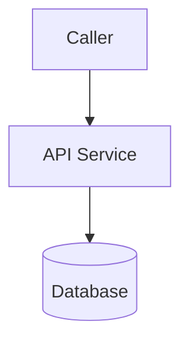

| Property | Value |
| :--- | :--- |
| Endpoints | 15 |
| Base path | `https://platform.nlproducts.net/o` |

## Architecture

## Endpoints

### POST `/headless-commerce-admin-account/v1.0/accountGroups/by-externalReferenceCode/{externalReferenceCode}/accounts`

[Account] HeadlessCommerceAdminAccount.v1.0.postAccountGroupByExternalReferenceCodeAccount

### DELETE `/headless-commerce-admin-account/v1.0/accountGroups/by-externalReferenceCode/{externalReferenceCode}/accounts/{accountExternalReferenceCode}`

[Account] HeadlessCommerceAdminAccount.v1.0.deleteAccountGroupByExternalReferenceCodeAccount

### GET `/headless-commerce-admin-account/v1.0/accounts`

[Account] HeadlessCommerceAdminAccount.v1.0.getAccountsPage

### POST `/headless-commerce-admin-account/v1.0/accounts`

[Account] HeadlessCommerceAdminAccount.v1.0.postAccount

### DELETE `/headless-commerce-admin-account/v1.0/accounts/batch`

[Account] HeadlessCommerceAdminAccount.v1.0.deleteAccountBatch

### POST `/headless-commerce-admin-account/v1.0/accounts/batch`

[Account] HeadlessCommerceAdminAccount.v1.0.postAccountBatch

### DELETE `/headless-commerce-admin-account/v1.0/accounts/by-externalReferenceCode/{externalReferenceCode}`

[Account] HeadlessCommerceAdminAccount.v1.0.deleteAccountByExternalReferenceCode

### GET `/headless-commerce-admin-account/v1.0/accounts/by-externalReferenceCode/{externalReferenceCode}`

[Account] HeadlessCommerceAdminAccount.v1.0.getAccountByExternalReferenceCode

### PATCH `/headless-commerce-admin-account/v1.0/accounts/by-externalReferenceCode/{externalReferenceCode}`

[Account] HeadlessCommerceAdminAccount.v1.0.patchAccountByExternalReferenceCode

### POST `/headless-commerce-admin-account/v1.0/accounts/by-externalReferenceCode/{externalReferenceCode}/logo`

[Account] HeadlessCommerceAdminAccount.v1.0.postAccountByExternalReferenceCodeLogo

### POST `/headless-commerce-admin-account/v1.0/accounts/export-batch`

[Account] HeadlessCommerceAdminAccount.v1.0.postAccountsPageExportBatch

### DELETE `/headless-commerce-admin-account/v1.0/accounts/{id}`

[Account] HeadlessCommerceAdminAccount.v1.0.deleteAccount

### GET `/headless-commerce-admin-account/v1.0/accounts/{id}`

[Account] HeadlessCommerceAdminAccount.v1.0.getAccount

### PATCH `/headless-commerce-admin-account/v1.0/accounts/{id}`

[Account] HeadlessCommerceAdminAccount.v1.0.patchAccount

### POST `/headless-commerce-admin-account/v1.0/accounts/{id}/logo`

[Account] HeadlessCommerceAdminAccount.v1.0.postAccountLogo
