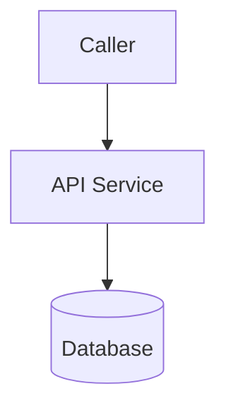

| Property | Value |
| :--- | :--- |
| Endpoints | 15 |
| Base path | `https://platform.nlproducts.net/o` |

## Architecture

## Endpoints

### DELETE `/headless-commerce-admin-catalog/v1.0/attachment/batch`

[Attachment] HeadlessCommerceAdminCatalog.v1.0.deleteAttachmentBatch

### DELETE `/headless-commerce-admin-catalog/v1.0/attachment/by-externalReferenceCode/{externalReferenceCode}`

[Attachment] HeadlessCommerceAdminCatalog.v1.0.deleteAttachmentByExternalReferenceCode

### GET `/headless-commerce-admin-catalog/v1.0/attachment/by-externalReferenceCode/{externalReferenceCode}`

[Attachment] HeadlessCommerceAdminCatalog.v1.0.getAttachmentByExternalReferenceCode

### PATCH `/headless-commerce-admin-catalog/v1.0/attachment/by-externalReferenceCode/{externalReferenceCode}`

[Attachment] HeadlessCommerceAdminCatalog.v1.0.patchAttachmentByExternalReferenceCode

### PUT `/headless-commerce-admin-catalog/v1.0/attachment/by-externalReferenceCode/{externalReferenceCode}`

[Attachment] HeadlessCommerceAdminCatalog.v1.0.putAttachmentByExternalReferenceCode

### DELETE `/headless-commerce-admin-catalog/v1.0/attachment/{id}`

[Attachment] HeadlessCommerceAdminCatalog.v1.0.deleteAttachment

### POST `/headless-commerce-admin-catalog/v1.0/products/attachments/batch`

[Attachment] HeadlessCommerceAdminCatalog.v1.0.postProductIdAttachmentBatch

### GET `/headless-commerce-admin-catalog/v1.0/products/by-externalReferenceCode/{externalReferenceCode}/attachments`

[Attachment] HeadlessCommerceAdminCatalog.v1.0.getProductByExternalReferenceCodeAttachmentsPage

### POST `/headless-commerce-admin-catalog/v1.0/products/by-externalReferenceCode/{externalReferenceCode}/attachments`

[Attachment] HeadlessCommerceAdminCatalog.v1.0.postProductByExternalReferenceCodeAttachment

### POST `/headless-commerce-admin-catalog/v1.0/products/by-externalReferenceCode/{externalReferenceCode}/attachments/by-base64`

[Attachment] HeadlessCommerceAdminCatalog.v1.0.postProductByExternalReferenceCodeAttachmentByBase64

### POST `/headless-commerce-admin-catalog/v1.0/products/by-externalReferenceCode/{externalReferenceCode}/attachments/by-url`

[Attachment] HeadlessCommerceAdminCatalog.v1.0.postProductByExternalReferenceCodeAttachmentByUrl

### GET `/headless-commerce-admin-catalog/v1.0/products/by-externalReferenceCode/{externalReferenceCode}/images`

[Attachment] HeadlessCommerceAdminCatalog.v1.0.getProductByExternalReferenceCodeImagesPage

### POST `/headless-commerce-admin-catalog/v1.0/products/by-externalReferenceCode/{externalReferenceCode}/images`

[Attachment] HeadlessCommerceAdminCatalog.v1.0.postProductByExternalReferenceCodeImage

### POST `/headless-commerce-admin-catalog/v1.0/products/by-externalReferenceCode/{externalReferenceCode}/images/by-base64`

[Attachment] HeadlessCommerceAdminCatalog.v1.0.postProductByExternalReferenceCodeImageByBase64

### POST `/headless-commerce-admin-catalog/v1.0/products/by-externalReferenceCode/{externalReferenceCode}/images/by-url`

[Attachment] HeadlessCommerceAdminCatalog.v1.0.postProductByExternalReferenceCodeImageByUrl
