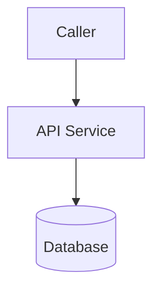

| Property | Value |
| :--- | :--- |
| Endpoints | 15 |
| Base path | `https://platform.nlproducts.net/o` |

## Architecture

## Endpoints

### GET `/headless-commerce-admin-channel/v1.0/channel-accounts/{channelAccountId}/account`

[Account] HeadlessCommerceAdminChannel.v1.0.getChannelAccountAccount

### DELETE `/headless-commerce-admin-channel/v1.0/account-address-channels/batch`

[AccountAddressChannel] HeadlessCommerceAdminChannel.v1.0.deleteAccountAddressChannelBatch

### DELETE `/headless-commerce-admin-channel/v1.0/account-address-channels/{accountAddressChannelId}`

[AccountAddressChannel] HeadlessCommerceAdminChannel.v1.0.deleteAccountAddressChannel

### GET `/headless-commerce-admin-channel/v1.0/account-addresses/by-externalReferenceCode/{externalReferenceCode}/account-address-channels`

[AccountAddressChannel] HeadlessCommerceAdminChannel.v1.0.getAccountAddressByExternalReferenceCodeAccountAddressChannelsPage

### POST `/headless-commerce-admin-channel/v1.0/account-addresses/by-externalReferenceCode/{externalReferenceCode}/account-address-channels`

[AccountAddressChannel] HeadlessCommerceAdminChannel.v1.0.postAccountAddressByExternalReferenceCodeAccountAddressChannel

### GET `/headless-commerce-admin-channel/v1.0/account-addresses/{addressId}/account-address-channels`

[AccountAddressChannel] HeadlessCommerceAdminChannel.v1.0.getAccountAddressIdAccountAddressChannelsPage

### POST `/headless-commerce-admin-channel/v1.0/account-addresses/{addressId}/account-address-channels`

[AccountAddressChannel] HeadlessCommerceAdminChannel.v1.0.postAccountAddressIdAccountAddressChannel

### DELETE `/headless-commerce-admin-channel/v1.0/category-display-pages/batch`

[CategoryDisplayPage] HeadlessCommerceAdminChannel.v1.0.deleteCategoryDisplayPageBatch

### DELETE `/headless-commerce-admin-channel/v1.0/category-display-pages/{id}`

[CategoryDisplayPage] HeadlessCommerceAdminChannel.v1.0.deleteCategoryDisplayPage

### GET `/headless-commerce-admin-channel/v1.0/category-display-pages/{id}`

[CategoryDisplayPage] HeadlessCommerceAdminChannel.v1.0.getCategoryDisplayPage

### PATCH `/headless-commerce-admin-channel/v1.0/category-display-pages/{id}`

[CategoryDisplayPage] HeadlessCommerceAdminChannel.v1.0.patchCategoryDisplayPage

### GET `/headless-commerce-admin-channel/v1.0/channels/by-externalReferenceCode/{externalReferenceCode}/category-display-pages`

[CategoryDisplayPage] HeadlessCommerceAdminChannel.v1.0.getChannelByExternalReferenceCodeCategoryDisplayPagesPage

### POST `/headless-commerce-admin-channel/v1.0/channels/by-externalReferenceCode/{externalReferenceCode}/category-display-pages`

[CategoryDisplayPage] HeadlessCommerceAdminChannel.v1.0.postChannelByExternalReferenceCodeCategoryDisplayPage

### GET `/headless-commerce-admin-channel/v1.0/channels/{id}/category-display-pages`

[CategoryDisplayPage] HeadlessCommerceAdminChannel.v1.0.getChannelIdCategoryDisplayPagesPage

### POST `/headless-commerce-admin-channel/v1.0/channels/{id}/category-display-pages`

[CategoryDisplayPage] HeadlessCommerceAdminChannel.v1.0.postChannelIdCategoryDisplayPage
