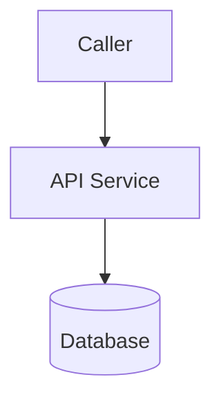

| Property | Value |
| :--- | :--- |
| Endpoints | 15 |
| Base path | `https://platform.nlproducts.net/o` |

## Architecture

## Endpoints

### GET `/headless-commerce-admin-inventory/v1.0/warehouse-accounts/{warehouseAccountId}/account`

[Account] HeadlessCommerceAdminInventory.v1.0.getWarehouseAccountAccount

### GET `/headless-commerce-admin-inventory/v1.0/warehouse-account-groups/{warehouseAccountGroupId}/account-group`

[AccountGroup] HeadlessCommerceAdminInventory.v1.0.getWarehouseAccountGroupAccountGroup

### GET `/headless-commerce-admin-inventory/v1.0/warehouse-channels/{warehouseChannelId}/channel`

[Channel] HeadlessCommerceAdminInventory.v1.0.getWarehouseChannelChannel

### GET `/headless-commerce-admin-inventory/v1.0/warehouse-order-types/{warehouseOrderTypeId}/order-type`

[OrderType] HeadlessCommerceAdminInventory.v1.0.getWarehouseOrderTypeOrderType

### DELETE `/headless-commerce-admin-inventory/v1.0/replenishment-items/batch`

[ReplenishmentItem] HeadlessCommerceAdminInventory.v1.0.deleteReplenishmentItemBatch

### DELETE `/headless-commerce-admin-inventory/v1.0/replenishment-items/by-externalReferenceCode/{externalReferenceCode}`

[ReplenishmentItem] HeadlessCommerceAdminInventory.v1.0.deleteReplenishmentItemByExternalReferenceCode

### GET `/headless-commerce-admin-inventory/v1.0/replenishment-items/by-externalReferenceCode/{externalReferenceCode}`

[ReplenishmentItem] HeadlessCommerceAdminInventory.v1.0.getReplenishmentItemByExternalReferenceCode

### PATCH `/headless-commerce-admin-inventory/v1.0/replenishment-items/by-externalReferenceCode/{externalReferenceCode}`

[ReplenishmentItem] HeadlessCommerceAdminInventory.v1.0.patchReplenishmentItemByExternalReferenceCode

### PUT `/headless-commerce-admin-inventory/v1.0/replenishment-items/by-externalReferenceCode/{externalReferenceCode}`

[ReplenishmentItem] HeadlessCommerceAdminInventory.v1.0.putReplenishmentItemByExternalReferenceCode

### DELETE `/headless-commerce-admin-inventory/v1.0/replenishment-items/{replenishmentItemId}`

[ReplenishmentItem] HeadlessCommerceAdminInventory.v1.0.deleteReplenishmentItem

### GET `/headless-commerce-admin-inventory/v1.0/replenishment-items/{replenishmentItemId}`

[ReplenishmentItem] HeadlessCommerceAdminInventory.v1.0.getReplenishmentItem

### PATCH `/headless-commerce-admin-inventory/v1.0/replenishment-items/{replenishmentItemId}`

[ReplenishmentItem] HeadlessCommerceAdminInventory.v1.0.patchReplenishmentItem

### GET `/headless-commerce-admin-inventory/v1.0/skus/by-sku/{sku}/replenishment-items`

[ReplenishmentItem] HeadlessCommerceAdminInventory.v1.0.getReplenishmentItemsPage

### POST `/headless-commerce-admin-inventory/v1.0/skus/by-sku/{sku}/replenishment-items/export-batch`

[ReplenishmentItem] HeadlessCommerceAdminInventory.v1.0.postReplenishmentItemsPageExportBatch

### GET `/headless-commerce-admin-inventory/v1.0/warehouses/{warehouseId}/replenishment-items`

[ReplenishmentItem] HeadlessCommerceAdminInventory.v1.0.getWarehouseIdReplenishmentItemsPage
