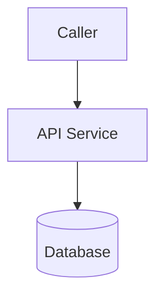

| Property | Value |
| :--- | :--- |
| Endpoints | 15 |
| Base path | `https://platform.nlproducts.net/o` |

## Architecture

## Endpoints

### GET `/headless-commerce-admin-order/v1.0/order-rule-accounts/{orderRuleAccountId}/account`

[Account] HeadlessCommerceAdminOrder.v1.0.getOrderRuleAccountAccount

### GET `/headless-commerce-admin-order/v1.0/orders/by-externalReferenceCode/{externalReferenceCode}/account`

[Account] HeadlessCommerceAdminOrder.v1.0.getOrderByExternalReferenceCodeAccount

### GET `/headless-commerce-admin-order/v1.0/orders/{id}/account`

[Account] HeadlessCommerceAdminOrder.v1.0.getOrderIdAccount

### GET `/headless-commerce-admin-order/v1.0/orders/by-externalReferenceCode/{externalReferenceCode}/billingAddress`

[BillingAddress] HeadlessCommerceAdminOrder.v1.0.getOrderByExternalReferenceCodeBillingAddress

### PATCH `/headless-commerce-admin-order/v1.0/orders/by-externalReferenceCode/{externalReferenceCode}/billingAddress`

[BillingAddress] HeadlessCommerceAdminOrder.v1.0.patchOrderByExternalReferenceCodeBillingAddress

### GET `/headless-commerce-admin-order/v1.0/orders/{id}/billingAddress`

[BillingAddress] HeadlessCommerceAdminOrder.v1.0.getOrderIdBillingAddress

### PATCH `/headless-commerce-admin-order/v1.0/orders/{id}/billingAddress`

[BillingAddress] HeadlessCommerceAdminOrder.v1.0.patchOrderIdBillingAddress

### GET `/headless-commerce-admin-order/v1.0/order-rule-channels/{orderRuleChannelId}/channel`

[Channel] HeadlessCommerceAdminOrder.v1.0.getOrderRuleChannelChannel

### GET `/headless-commerce-admin-order/v1.0/order-type-channels/{orderTypeChannelId}/channel`

[Channel] HeadlessCommerceAdminOrder.v1.0.getOrderTypeChannelChannel

### GET `/headless-commerce-admin-order/v1.0/orders/by-externalReferenceCode/{externalReferenceCode}/channel`

[Channel] HeadlessCommerceAdminOrder.v1.0.getOrderByExternalReferenceCodeChannel

### GET `/headless-commerce-admin-order/v1.0/orders/{id}/channel`

[Channel] HeadlessCommerceAdminOrder.v1.0.getOrderIdChannel

### GET `/headless-commerce-admin-order/v1.0/orders`

[Order] HeadlessCommerceAdminOrder.v1.0.getOrdersPage

### POST `/headless-commerce-admin-order/v1.0/orders`

[Order] HeadlessCommerceAdminOrder.v1.0.postOrder

### DELETE `/headless-commerce-admin-order/v1.0/orders/batch`

[Order] HeadlessCommerceAdminOrder.v1.0.deleteOrderBatch

### POST `/headless-commerce-admin-order/v1.0/orders/batch`

[Order] HeadlessCommerceAdminOrder.v1.0.postOrderBatch
