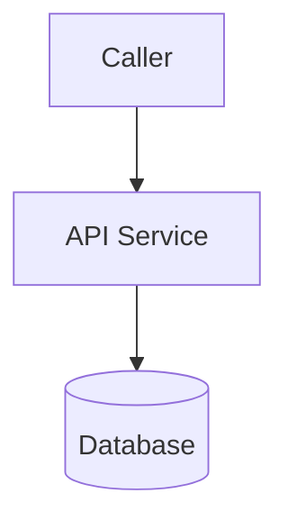

| Property | Value |
| :--- | :--- |
| Endpoints | 14 |
| Base path | `https://platform.nlproducts.net/o` |

## Architecture

## Endpoints

### GET `/headless-commerce-admin-payment/v1.0/payments`

[Payment] HeadlessCommerceAdminPayment.v1.0.getPaymentsPage

### POST `/headless-commerce-admin-payment/v1.0/payments`

[Payment] HeadlessCommerceAdminPayment.v1.0.postPayment

### DELETE `/headless-commerce-admin-payment/v1.0/payments/batch`

[Payment] HeadlessCommerceAdminPayment.v1.0.deletePaymentBatch

### POST `/headless-commerce-admin-payment/v1.0/payments/batch`

[Payment] HeadlessCommerceAdminPayment.v1.0.postPaymentBatch

### DELETE `/headless-commerce-admin-payment/v1.0/payments/by-externalReferenceCode/{externalReferenceCode}`

[Payment] HeadlessCommerceAdminPayment.v1.0.deletePaymentByExternalReferenceCode

### GET `/headless-commerce-admin-payment/v1.0/payments/by-externalReferenceCode/{externalReferenceCode}`

[Payment] HeadlessCommerceAdminPayment.v1.0.getPaymentByExternalReferenceCode

### PATCH `/headless-commerce-admin-payment/v1.0/payments/by-externalReferenceCode/{externalReferenceCode}`

[Payment] HeadlessCommerceAdminPayment.v1.0.patchPaymentByExternalReferenceCode

### PUT `/headless-commerce-admin-payment/v1.0/payments/by-externalReferenceCode/{externalReferenceCode}`

[Payment] HeadlessCommerceAdminPayment.v1.0.putPaymentByExternalReferenceCode

### POST `/headless-commerce-admin-payment/v1.0/payments/by-externalReferenceCode/{externalReferenceCode}/refund`

[Payment] HeadlessCommerceAdminPayment.v1.0.postPaymentByExternalReferenceCodeRefund

### POST `/headless-commerce-admin-payment/v1.0/payments/export-batch`

[Payment] HeadlessCommerceAdminPayment.v1.0.postPaymentsPageExportBatch

### DELETE `/headless-commerce-admin-payment/v1.0/payments/{id}`

[Payment] HeadlessCommerceAdminPayment.v1.0.deletePayment

### GET `/headless-commerce-admin-payment/v1.0/payments/{id}`

[Payment] HeadlessCommerceAdminPayment.v1.0.getPayment

### PATCH `/headless-commerce-admin-payment/v1.0/payments/{id}`

[Payment] HeadlessCommerceAdminPayment.v1.0.patchPayment

### POST `/headless-commerce-admin-payment/v1.0/payments/{id}/refund`

[Payment] HeadlessCommerceAdminPayment.v1.0.postPaymentRefund
