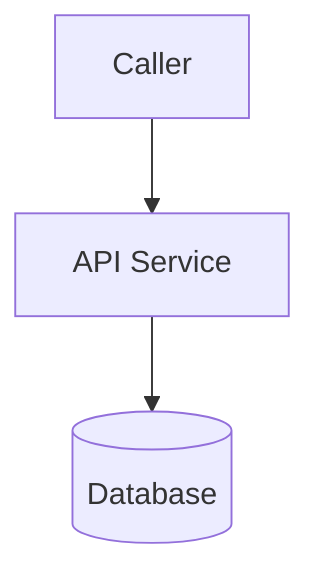

| Property | Value |
| :--- | :--- |
| Endpoints | 15 |
| Base path | `https://platform.nlproducts.net/o` |

## Architecture

## Endpoints

### GET `/headless-commerce-admin-pricing/v1.0/discounts`

[Discount] HeadlessCommerceAdminPricing.v1.0.getDiscountsPage

### POST `/headless-commerce-admin-pricing/v1.0/discounts`

[Discount] HeadlessCommerceAdminPricing.v1.0.postDiscount

### DELETE `/headless-commerce-admin-pricing/v1.0/discounts/batch`

[Discount] HeadlessCommerceAdminPricing.v1.0.deleteDiscountBatch

### POST `/headless-commerce-admin-pricing/v1.0/discounts/batch`

[Discount] HeadlessCommerceAdminPricing.v1.0.postDiscountBatch

### DELETE `/headless-commerce-admin-pricing/v1.0/discounts/by-externalReferenceCode/{externalReferenceCode}`

[Discount] HeadlessCommerceAdminPricing.v1.0.deleteDiscountByExternalReferenceCode

### GET `/headless-commerce-admin-pricing/v1.0/discounts/by-externalReferenceCode/{externalReferenceCode}`

[Discount] HeadlessCommerceAdminPricing.v1.0.getDiscountByExternalReferenceCode

### PATCH `/headless-commerce-admin-pricing/v1.0/discounts/by-externalReferenceCode/{externalReferenceCode}`

[Discount] HeadlessCommerceAdminPricing.v1.0.patchDiscountByExternalReferenceCode

### PUT `/headless-commerce-admin-pricing/v1.0/discounts/by-externalReferenceCode/{externalReferenceCode}`

[Discount] HeadlessCommerceAdminPricing.v1.0.putDiscountByExternalReferenceCode

### POST `/headless-commerce-admin-pricing/v1.0/discounts/export-batch`

[Discount] HeadlessCommerceAdminPricing.v1.0.postDiscountsPageExportBatch

### DELETE `/headless-commerce-admin-pricing/v1.0/discounts/{id}`

[Discount] HeadlessCommerceAdminPricing.v1.0.deleteDiscount

### GET `/headless-commerce-admin-pricing/v1.0/discounts/{id}`

[Discount] HeadlessCommerceAdminPricing.v1.0.getDiscount

### PATCH `/headless-commerce-admin-pricing/v1.0/discounts/{id}`

[Discount] HeadlessCommerceAdminPricing.v1.0.patchDiscount

### DELETE `/headless-commerce-admin-pricing/v1.0/discountAccountGroups/batch`

[DiscountAccountGroup] HeadlessCommerceAdminPricing.v1.0.deleteDiscountAccountGroupBatch

### DELETE `/headless-commerce-admin-pricing/v1.0/discountAccountGroups/{id}`

[DiscountAccountGroup] HeadlessCommerceAdminPricing.v1.0.deleteDiscountAccountGroup

### GET `/headless-commerce-admin-pricing/v1.0/discounts/by-externalReferenceCode/{externalReferenceCode}/discountAccountGroups`

[DiscountAccountGroup] HeadlessCommerceAdminPricing.v1.0.getDiscountByExternalReferenceCodeDiscountAccountGroupsPage
