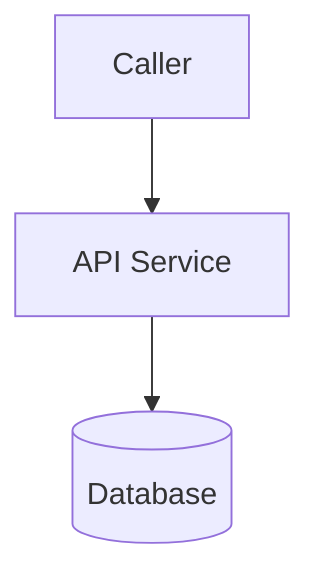

| Property | Value |
| :--- | :--- |
| Endpoints | 15 |
| Base path | `https://platform.nlproducts.net/o` |

## Architecture

## Endpoints

### GET `/headless-commerce-admin-shipment/v1.0/shipments`

[Shipment] HeadlessCommerceAdminShipment.v1.0.getShipmentsPage

### POST `/headless-commerce-admin-shipment/v1.0/shipments`

[Shipment] HeadlessCommerceAdminShipment.v1.0.postShipment

### DELETE `/headless-commerce-admin-shipment/v1.0/shipments/batch`

[Shipment] HeadlessCommerceAdminShipment.v1.0.deleteShipmentBatch

### POST `/headless-commerce-admin-shipment/v1.0/shipments/batch`

[Shipment] HeadlessCommerceAdminShipment.v1.0.postShipmentBatch

### DELETE `/headless-commerce-admin-shipment/v1.0/shipments/by-externalReferenceCode/{externalReferenceCode}`

[Shipment] HeadlessCommerceAdminShipment.v1.0.deleteShipmentByExternalReferenceCode

### GET `/headless-commerce-admin-shipment/v1.0/shipments/by-externalReferenceCode/{externalReferenceCode}`

[Shipment] HeadlessCommerceAdminShipment.v1.0.getShipmentByExternalReferenceCode

### PATCH `/headless-commerce-admin-shipment/v1.0/shipments/by-externalReferenceCode/{externalReferenceCode}`

[Shipment] HeadlessCommerceAdminShipment.v1.0.patchShipmentByExternalReferenceCode

### PUT `/headless-commerce-admin-shipment/v1.0/shipments/by-externalReferenceCode/{externalReferenceCode}`

[Shipment] HeadlessCommerceAdminShipment.v1.0.putShipmentByExternalReferenceCode

### POST `/headless-commerce-admin-shipment/v1.0/shipments/by-externalReferenceCode/{externalReferenceCode}/status-delivered`

[Shipment] HeadlessCommerceAdminShipment.v1.0.postShipmentByExternalReferenceCodeStatusDelivered

### POST `/headless-commerce-admin-shipment/v1.0/shipments/by-externalReferenceCode/{externalReferenceCode}/status-finish-processing`

[Shipment] HeadlessCommerceAdminShipment.v1.0.postShipmentByExternalReferenceCodeStatusFinishProcessing

### POST `/headless-commerce-admin-shipment/v1.0/shipments/by-externalReferenceCode/{externalReferenceCode}/status-shipped`

[Shipment] HeadlessCommerceAdminShipment.v1.0.postShipmentByExternalReferenceCodeStatusShipped

### POST `/headless-commerce-admin-shipment/v1.0/shipments/export-batch`

[Shipment] HeadlessCommerceAdminShipment.v1.0.postShipmentsPageExportBatch

### DELETE `/headless-commerce-admin-shipment/v1.0/shipments/{shipmentId}`

[Shipment] HeadlessCommerceAdminShipment.v1.0.deleteShipment

### GET `/headless-commerce-admin-shipment/v1.0/shipments/{shipmentId}`

[Shipment] HeadlessCommerceAdminShipment.v1.0.getShipment

### PATCH `/headless-commerce-admin-shipment/v1.0/shipments/{shipmentId}`

[Shipment] HeadlessCommerceAdminShipment.v1.0.patchShipment
