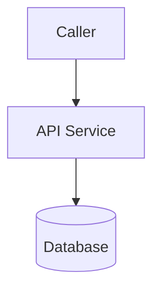

| Property | Value |
| :--- | :--- |
| Endpoints | 15 |
| Base path | `https://platform.nlproducts.net/o` |

## Architecture

## Endpoints

### DELETE `/headless-commerce-admin-site-setting/v1.0/availabilityEstimate/batch`

[AvailabilityEstimate] HeadlessCommerceAdminSiteSetting.v1.0.deleteAvailabilityEstimateBatch

### PUT `/headless-commerce-admin-site-setting/v1.0/availabilityEstimate/batch`

[AvailabilityEstimate] HeadlessCommerceAdminSiteSetting.v1.0.putAvailabilityEstimateBatch

### DELETE `/headless-commerce-admin-site-setting/v1.0/availabilityEstimate/{id}`

[AvailabilityEstimate] HeadlessCommerceAdminSiteSetting.v1.0.deleteAvailabilityEstimate

### GET `/headless-commerce-admin-site-setting/v1.0/availabilityEstimate/{id}`

[AvailabilityEstimate] HeadlessCommerceAdminSiteSetting.v1.0.getAvailabilityEstimate

### PUT `/headless-commerce-admin-site-setting/v1.0/availabilityEstimate/{id}`

[AvailabilityEstimate] HeadlessCommerceAdminSiteSetting.v1.0.putAvailabilityEstimate

### GET `/headless-commerce-admin-site-setting/v1.0/commerceAdminSiteSetting/{groupId}/availabilityEstimate`

[AvailabilityEstimate] HeadlessCommerceAdminSiteSetting.v1.0.getCommerceAdminSiteSettingGroupAvailabilityEstimatePage

### POST `/headless-commerce-admin-site-setting/v1.0/commerceAdminSiteSetting/{groupId}/availabilityEstimate`

[AvailabilityEstimate] HeadlessCommerceAdminSiteSetting.v1.0.postCommerceAdminSiteSettingGroupAvailabilityEstimate

### GET `/headless-commerce-admin-site-setting/v1.0/measurement-units`

[MeasurementUnit] HeadlessCommerceAdminSiteSetting.v1.0.getMeasurementUnitsPage

### POST `/headless-commerce-admin-site-setting/v1.0/measurement-units`

[MeasurementUnit] HeadlessCommerceAdminSiteSetting.v1.0.postMeasurementUnit

### DELETE `/headless-commerce-admin-site-setting/v1.0/measurement-units/batch`

[MeasurementUnit] HeadlessCommerceAdminSiteSetting.v1.0.deleteMeasurementUnitBatch

### POST `/headless-commerce-admin-site-setting/v1.0/measurement-units/batch`

[MeasurementUnit] HeadlessCommerceAdminSiteSetting.v1.0.postMeasurementUnitBatch

### DELETE `/headless-commerce-admin-site-setting/v1.0/measurement-units/by-externalReferenceCode/{externalReferenceCode}`

[MeasurementUnit] HeadlessCommerceAdminSiteSetting.v1.0.deleteMeasurementUnitByExternalReferenceCode

### GET `/headless-commerce-admin-site-setting/v1.0/measurement-units/by-externalReferenceCode/{externalReferenceCode}`

[MeasurementUnit] HeadlessCommerceAdminSiteSetting.v1.0.getMeasurementUnitByExternalReferenceCode

### PATCH `/headless-commerce-admin-site-setting/v1.0/measurement-units/by-externalReferenceCode/{externalReferenceCode}`

[MeasurementUnit] HeadlessCommerceAdminSiteSetting.v1.0.patchMeasurementUnitByExternalReferenceCode

### PUT `/headless-commerce-admin-site-setting/v1.0/measurement-units/by-externalReferenceCode/{externalReferenceCode}`

[MeasurementUnit] HeadlessCommerceAdminSiteSetting.v1.0.putMeasurementUnitByExternalReferenceCode
