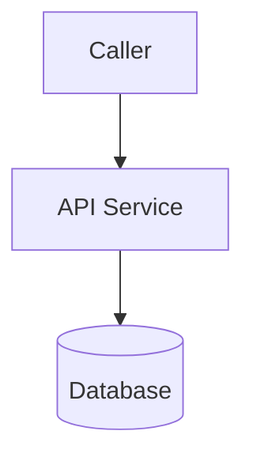

| Property | Value |
| :--- | :--- |
| Endpoints | 15 |
| Base path | `https://platform.nlproducts.net/o` |

## Architecture

## Endpoints

### GET `/headless-commerce-delivery-cart/v1.0/carts/by-externalReferenceCode/{externalReferenceCode}/billing-address`

[Address] HeadlessCommerceDeliveryCart.v1.0.getCartByExternalReferenceCodeBillingAddress

### GET `/headless-commerce-delivery-cart/v1.0/carts/by-externalReferenceCode/{externalReferenceCode}/shipping-address`

[Address] HeadlessCommerceDeliveryCart.v1.0.getCartByExternalReferenceCodeShippingAddress

### GET `/headless-commerce-delivery-cart/v1.0/carts/{cartId}/billing-address`

[Address] HeadlessCommerceDeliveryCart.v1.0.getCartBillingAddres

### GET `/headless-commerce-delivery-cart/v1.0/carts/{cartId}/shipping-address`

[Address] HeadlessCommerceDeliveryCart.v1.0.getCartShippingAddres

### GET `/headless-commerce-delivery-cart/v1.0/carts/by-externalReferenceCode/{externalReferenceCode}/attachments`

[Attachment] HeadlessCommerceDeliveryCart.v1.0.getCartByExternalReferenceCodeAttachmentsPage

### POST `/headless-commerce-delivery-cart/v1.0/carts/by-externalReferenceCode/{externalReferenceCode}/attachments/by-base64`

[Attachment] HeadlessCommerceDeliveryCart.v1.0.postCartByExternalReferenceCodeAttachmentByBase64

### DELETE `/headless-commerce-delivery-cart/v1.0/carts/by-externalReferenceCode/{externalReferenceCode}/attachments/by-externalReferenceCode/{attachmentExternalReferenceCode}`

[Attachment] HeadlessCommerceDeliveryCart.v1.0.deleteCartByExternalReferenceCodeAttachmentByExternalReferenceCodeAttachmentExternalReferenceCode

### GET `/headless-commerce-delivery-cart/v1.0/carts/{cartId}/attachments`

[Attachment] HeadlessCommerceDeliveryCart.v1.0.getCartAttachmentsPage

### POST `/headless-commerce-delivery-cart/v1.0/carts/{cartId}/attachments/by-base64`

[Attachment] HeadlessCommerceDeliveryCart.v1.0.postCartAttachmentByBase64

### POST `/headless-commerce-delivery-cart/v1.0/carts/{cartId}/attachments/export-batch`

[Attachment] HeadlessCommerceDeliveryCart.v1.0.postCartAttachmentsPageExportBatch

### DELETE `/headless-commerce-delivery-cart/v1.0/carts/{cartId}/attachments/{attachmentId}`

[Attachment] HeadlessCommerceDeliveryCart.v1.0.deleteCartAttachment

### DELETE `/headless-commerce-delivery-cart/v1.0/carts/batch`

[Cart] HeadlessCommerceDeliveryCart.v1.0.deleteCartBatch

### PUT `/headless-commerce-delivery-cart/v1.0/carts/batch`

[Cart] HeadlessCommerceDeliveryCart.v1.0.putCartBatch

### DELETE `/headless-commerce-delivery-cart/v1.0/carts/by-externalReferenceCode/{externalReferenceCode}`

[Cart] HeadlessCommerceDeliveryCart.v1.0.deleteCartByExternalReferenceCode

### GET `/headless-commerce-delivery-cart/v1.0/carts/by-externalReferenceCode/{externalReferenceCode}`

[Cart] HeadlessCommerceDeliveryCart.v1.0.getCartByExternalReferenceCode
