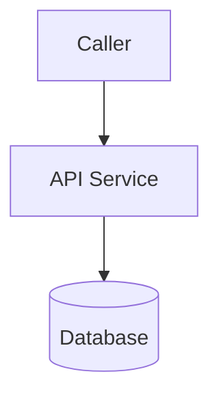

| Property | Value |
| :--- | :--- |
| Endpoints | 15 |
| Base path | `https://platform.nlproducts.net/o` |

## Architecture

## Endpoints

### GET `/headless-commerce-delivery-catalog/v1.0/channels/{channelId}/accounts`

[Account] HeadlessCommerceDeliveryCatalog.v1.0.getChannelAccountsPage

### POST `/headless-commerce-delivery-catalog/v1.0/channels/{channelId}/accounts`

[Account] HeadlessCommerceDeliveryCatalog.v1.0.postChannelAccount

### GET `/headless-commerce-delivery-catalog/v1.0/channels/{channelId}/products/{productId}/attachments`

[Attachment] HeadlessCommerceDeliveryCatalog.v1.0.getChannelProductAttachmentsPage

### GET `/headless-commerce-delivery-catalog/v1.0/channels/{channelId}/products/{productId}/images`

[Attachment] HeadlessCommerceDeliveryCatalog.v1.0.getChannelProductImagesPage

### GET `/headless-commerce-delivery-catalog/v1.0/channels/{channelId}/products/{productId}/categories`

[Category] HeadlessCommerceDeliveryCatalog.v1.0.getChannelProductCategoriesPage

### GET `/headless-commerce-delivery-catalog/v1.0/channels`

[Channel] HeadlessCommerceDeliveryCatalog.v1.0.getChannelsPage

### POST `/headless-commerce-delivery-catalog/v1.0/channels/export-batch`

[Channel] HeadlessCommerceDeliveryCatalog.v1.0.postChannelsPageExportBatch

### GET `/headless-commerce-delivery-catalog/v1.0/channels/{channelId}/products/{productId}/linked-products`

[LinkedProduct] HeadlessCommerceDeliveryCatalog.v1.0.getChannelProductLinkedProductsPage

### GET `/headless-commerce-delivery-catalog/v1.0/channels/{channelId}/products/{productId}/mapped-products`

[MappedProduct] HeadlessCommerceDeliveryCatalog.v1.0.getChannelProductMappedProductsPage

### GET `/headless-commerce-delivery-catalog/v1.0/channels/by-externalReferenceCode/{channelExternalReferenceCode}/products/by-externalReferenceCode/{productExternalReferenceCode}/pins`

[Pin] HeadlessCommerceDeliveryCatalog.v1.0.getChannelByExternalReferenceCodeChannelExternalReferenceCodeProductByExternalReferenceCodeProductExternalReferenceCodePinsPage

### GET `/headless-commerce-delivery-catalog/v1.0/channels/{channelId}/products/{productId}/pins`

[Pin] HeadlessCommerceDeliveryCatalog.v1.0.getChannelProductPinsPage

### GET `/headless-commerce-delivery-catalog/v1.0/channels/{channelId}/products`

[Product] HeadlessCommerceDeliveryCatalog.v1.0.getChannelProductsPage

### GET `/headless-commerce-delivery-catalog/v1.0/channels/{channelId}/products/{productId}`

[Product] HeadlessCommerceDeliveryCatalog.v1.0.getChannelProduct

### GET `/headless-commerce-delivery-catalog/v1.0/channels/by-externalReferenceCode/{channelExternalReferenceCode}/products/by-externalReferenceCode/{productExternalReferenceCode}/product-options`

[ProductOption] HeadlessCommerceDeliveryCatalog.v1.0.getChannelByExternalReferenceCodeChannelExternalReferenceCodeProductByExternalReferenceCodeProductExternalReferenceCodeProductOptionsPage

### GET `/headless-commerce-delivery-catalog/v1.0/channels/{channelId}/products/{productId}/product-options`

[ProductOption] HeadlessCommerceDeliveryCatalog.v1.0.getChannelProductProductOptionsPage
