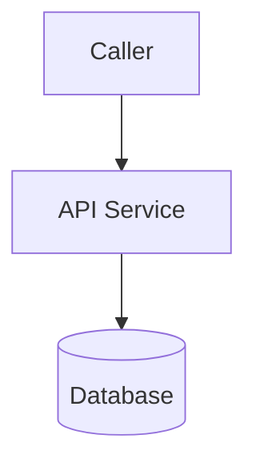

| Property | Value |
| :--- | :--- |
| Endpoints | 15 |
| Base path | `https://platform.nlproducts.net/o` |

## Architecture

## Endpoints

### GET `/headless-commerce-delivery-order/v1.0/placed-orders/by-externalReferenceCode/{externalReferenceCode}/attachments`

[Attachment] HeadlessCommerceDeliveryOrder.v1.0.getPlacedOrderByExternalReferenceCodeAttachmentsPage

### POST `/headless-commerce-delivery-order/v1.0/placed-orders/by-externalReferenceCode/{externalReferenceCode}/attachments/by-base64`

[Attachment] HeadlessCommerceDeliveryOrder.v1.0.postPlacedOrderByExternalReferenceCodeAttachmentByBase64

### DELETE `/headless-commerce-delivery-order/v1.0/placed-orders/by-externalReferenceCode/{externalReferenceCode}/attachments/by-externalReferenceCode/{attachmentExternalReferenceCode}`

[Attachment] HeadlessCommerceDeliveryOrder.v1.0.deletePlacedOrderByExternalReferenceCodeAttachmentByExternalReferenceCodeAttachmentExternalReferenceCode

### GET `/headless-commerce-delivery-order/v1.0/placed-orders/{placedOrderId}/attachments`

[Attachment] HeadlessCommerceDeliveryOrder.v1.0.getPlacedOrderAttachmentsPage

### POST `/headless-commerce-delivery-order/v1.0/placed-orders/{placedOrderId}/attachments/by-base64`

[Attachment] HeadlessCommerceDeliveryOrder.v1.0.postPlacedOrderAttachmentByBase64

### POST `/headless-commerce-delivery-order/v1.0/placed-orders/{placedOrderId}/attachments/export-batch`

[Attachment] HeadlessCommerceDeliveryOrder.v1.0.postPlacedOrderAttachmentsPageExportBatch

### DELETE `/headless-commerce-delivery-order/v1.0/placed-orders/{placedOrderId}/attachments/{attachmentId}`

[Attachment] HeadlessCommerceDeliveryOrder.v1.0.deletePlacedOrderAttachment

### GET `/headless-commerce-delivery-order/v1.0/placed-orders/{placedOrderId}/order-transitions`

[OrderTransition] HeadlessCommerceDeliveryOrder.v1.0.getPlacedOrderOrderTransitionsPage

### POST `/headless-commerce-delivery-order/v1.0/placed-orders/{placedOrderId}/order-transitions`

[OrderTransition] HeadlessCommerceDeliveryOrder.v1.0.postPlacedOrderOrderTransition

### POST `/headless-commerce-delivery-order/v1.0/placed-orders/{placedOrderId}/order-transitions/batch`

[OrderTransition] HeadlessCommerceDeliveryOrder.v1.0.postPlacedOrderOrderTransitionBatch

### POST `/headless-commerce-delivery-order/v1.0/placed-orders/{placedOrderId}/order-transitions/export-batch`

[OrderTransition] HeadlessCommerceDeliveryOrder.v1.0.postPlacedOrderOrderTransitionsPageExportBatch

### GET `/headless-commerce-delivery-order/v1.0/channels/by-externalReferenceCode/{channelExternalReferenceCode}/accounts/by-externalReferenceCode/{accountExternalReferenceCode}/placed-orders`

[PlacedOrder] HeadlessCommerceDeliveryOrder.v1.0.getChannelByExternalReferenceCodeChannelExternalReferenceCodeAccountByExternalReferenceCodeAccountExternalReferenceCodePlacedOrdersPage

### GET `/headless-commerce-delivery-order/v1.0/channels/by-externalReferenceCode/{externalReferenceCode}/placed-orders`

[PlacedOrder] HeadlessCommerceDeliveryOrder.v1.0.getChannelByExternalReferenceCodePlacedOrdersPage

### GET `/headless-commerce-delivery-order/v1.0/channels/{channelId}/accounts/{accountId}/placed-orders`

[PlacedOrder] HeadlessCommerceDeliveryOrder.v1.0.getChannelAccountPlacedOrdersPage

### GET `/headless-commerce-delivery-order/v1.0/channels/{channelId}/placed-orders`

[PlacedOrder] HeadlessCommerceDeliveryOrder.v1.0.getChannelPlacedOrdersPage
