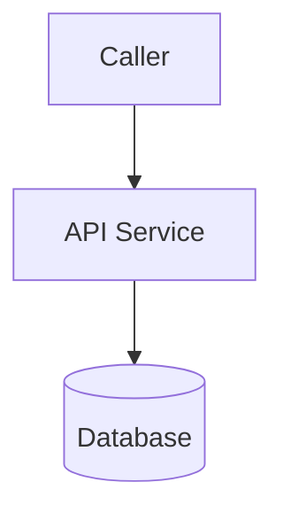

| Property | Value |
| :--- | :--- |
| Endpoints | 15 |
| Base path | `https://platform.nlproducts.net/o` |

## Architecture

## Endpoints

### DELETE `/headless-delivery/v1.0/blog-postings/batch`

[BlogPosting] HeadlessDelivery.v1.0.deleteBlogPostingBatch

### PUT `/headless-delivery/v1.0/blog-postings/batch`

[BlogPosting] HeadlessDelivery.v1.0.putBlogPostingBatch

### DELETE `/headless-delivery/v1.0/blog-postings/{blogPostingId}`

[BlogPosting] HeadlessDelivery.v1.0.deleteBlogPosting

### GET `/headless-delivery/v1.0/blog-postings/{blogPostingId}`

[BlogPosting] HeadlessDelivery.v1.0.getBlogPosting

### PATCH `/headless-delivery/v1.0/blog-postings/{blogPostingId}`

[BlogPosting] HeadlessDelivery.v1.0.patchBlogPosting

### PUT `/headless-delivery/v1.0/blog-postings/{blogPostingId}`

[BlogPosting] HeadlessDelivery.v1.0.putBlogPosting

### DELETE `/headless-delivery/v1.0/blog-postings/{blogPostingId}/my-rating`

[BlogPosting] HeadlessDelivery.v1.0.deleteBlogPostingMyRating

### GET `/headless-delivery/v1.0/blog-postings/{blogPostingId}/my-rating`

[BlogPosting] HeadlessDelivery.v1.0.getBlogPostingMyRating

### POST `/headless-delivery/v1.0/blog-postings/{blogPostingId}/my-rating`

[BlogPosting] HeadlessDelivery.v1.0.postBlogPostingMyRating

### PUT `/headless-delivery/v1.0/blog-postings/{blogPostingId}/my-rating`

[BlogPosting] HeadlessDelivery.v1.0.putBlogPostingMyRating

### GET `/headless-delivery/v1.0/blog-postings/{blogPostingId}/permissions`

[BlogPosting] HeadlessDelivery.v1.0.getBlogPostingPermissionsPage

### PUT `/headless-delivery/v1.0/blog-postings/{blogPostingId}/permissions`

[BlogPosting] HeadlessDelivery.v1.0.putBlogPostingPermissionsPage

### GET `/headless-delivery/v1.0/blog-postings/{blogPostingId}/rendered-content-by-display-page/{displayPageKey}`

[BlogPosting] HeadlessDelivery.v1.0.getBlogPostingRenderedContentByDisplayPageDisplayPageKey

### GET `/headless-delivery/v1.0/sites/{siteId}/blog-postings`

[BlogPosting] HeadlessDelivery.v1.0.getSiteBlogPostingsPage

### POST `/headless-delivery/v1.0/sites/{siteId}/blog-postings`

[BlogPosting] HeadlessDelivery.v1.0.postSiteBlogPosting
