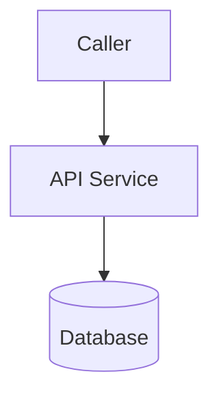

| Property | Value |
| :--- | :--- |
| Endpoints | 15 |
| Base path | `https://platform.nlproducts.net/o` |

## Architecture

## Endpoints

### GET `/headless-form/v1.0/forms/{formId}`

[Form] HeadlessForm.v1.0.getForm

### POST `/headless-form/v1.0/forms/{formId}/evaluate-context`

[Form] HeadlessForm.v1.0.postFormEvaluateContext

### POST `/headless-form/v1.0/forms/{formId}/form-document`

[Form] HeadlessForm.v1.0.postFormFormDocument

### GET `/headless-form/v1.0/sites/{siteId}/forms`

[Form] HeadlessForm.v1.0.getSiteFormsPage

### POST `/headless-form/v1.0/sites/{siteId}/forms/export-batch`

[Form] HeadlessForm.v1.0.postSiteFormsPageExportBatch

### DELETE `/headless-form/v1.0/form-documents/batch`

[FormDocument] HeadlessForm.v1.0.deleteFormDocumentBatch

### DELETE `/headless-form/v1.0/form-documents/{formDocumentId}`

[FormDocument] HeadlessForm.v1.0.deleteFormDocument

### GET `/headless-form/v1.0/form-documents/{formDocumentId}`

[FormDocument] HeadlessForm.v1.0.getFormDocument

### PUT `/headless-form/v1.0/form-records/batch`

[FormRecord] HeadlessForm.v1.0.putFormRecordBatch

### GET `/headless-form/v1.0/form-records/{formRecordId}`

[FormRecord] HeadlessForm.v1.0.getFormRecord

### PUT `/headless-form/v1.0/form-records/{formRecordId}`

[FormRecord] HeadlessForm.v1.0.putFormRecord

### GET `/headless-form/v1.0/forms/{formId}/form-records`

[FormRecord] HeadlessForm.v1.0.getFormFormRecordsPage

### POST `/headless-form/v1.0/forms/{formId}/form-records`

[FormRecord] HeadlessForm.v1.0.postFormFormRecord

### POST `/headless-form/v1.0/forms/{formId}/form-records/batch`

[FormRecord] HeadlessForm.v1.0.postFormFormRecordBatch

### GET `/headless-form/v1.0/forms/{formId}/form-records/by-latest-draft`

[FormRecord] HeadlessForm.v1.0.getFormFormRecordByLatestDraft
