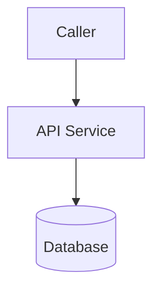

| Property | Value |
| :--- | :--- |
| Endpoints | 7 |
| Base path | `https://platform.nlproducts.net/o` |

## Architecture

## Endpoints

### GET `/headless-portal-instances/v1.0/portal-instances`

[PortalInstance] HeadlessPortalInstances.v1.0.getPortalInstancesPage

### POST `/headless-portal-instances/v1.0/portal-instances`

[PortalInstance] HeadlessPortalInstances.v1.0.postPortalInstance

### DELETE `/headless-portal-instances/v1.0/portal-instances/{portalInstanceId}`

[PortalInstance] HeadlessPortalInstances.v1.0.deletePortalInstance

### GET `/headless-portal-instances/v1.0/portal-instances/{portalInstanceId}`

[PortalInstance] HeadlessPortalInstances.v1.0.getPortalInstance

### PATCH `/headless-portal-instances/v1.0/portal-instances/{portalInstanceId}`

[PortalInstance] HeadlessPortalInstances.v1.0.patchPortalInstance

### PUT `/headless-portal-instances/v1.0/portal-instances/{portalInstanceId}/activate`

[PortalInstance] HeadlessPortalInstances.v1.0.putPortalInstanceActivate

### PUT `/headless-portal-instances/v1.0/portal-instances/{portalInstanceId}/deactivate`

[PortalInstance] HeadlessPortalInstances.v1.0.putPortalInstanceDeactivate
