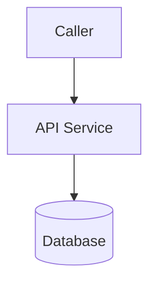

| Property | Value |
| :--- | :--- |
| Endpoints | 6 |
| Base path | `https://platform.nlproducts.net/o` |

## Architecture

## Endpoints

### POST `/headless-site/v1.0/sites`

[Site] HeadlessSite.v1.0.postSite_1

### DELETE `/headless-site/v1.0/sites/by-external-reference-code/{externalReferenceCode}`

[Site] HeadlessSite.v1.0.deleteSiteByExternalReferenceCode

### GET `/headless-site/v1.0/sites/by-external-reference-code/{externalReferenceCode}`

[Site] HeadlessSite.v1.0.getSiteByExternalReferenceCode

### PUT `/headless-site/v1.0/sites/by-external-reference-code/{externalReferenceCode}`

[Site] HeadlessSite.v1.0.putSiteByExternalReferenceCode

### GET `/headless-site/v1.0/sites/by-external-reference-code/{externalReferenceCode}/site-initializer`

[Site] HeadlessSite.v1.0.getSiteByExternalReferenceCodeSiteInitializer

### DELETE `/headless-site/v1.0/sites/{siteId}`

[Site] HeadlessSite.v1.0.deleteSite
