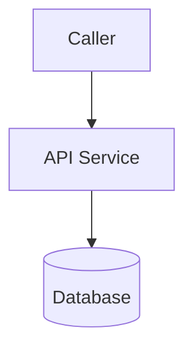

| Property | Value |
| :--- | :--- |
| Endpoints | 5 |
| Base path | `https://platform.nlproducts.net/o` |

## Architecture

## Endpoints

### GET `/headless-user-notification/v1.0/my-user-notifications`

[UserNotification] HeadlessUserNotification.v1.0.getMyUserNotificationsPage

### GET `/headless-user-notification/v1.0/user-accounts/{userAccountId}/user-notifications`

[UserNotification] HeadlessUserNotification.v1.0.getUserAccountUserNotificationsPage

### GET `/headless-user-notification/v1.0/user-notifications/{userNotificationId}`

[UserNotification] HeadlessUserNotification.v1.0.getUserNotification

### PUT `/headless-user-notification/v1.0/user-notifications/{userNotificationId}/read`

[UserNotification] HeadlessUserNotification.v1.0.putUserNotificationRead

### PUT `/headless-user-notification/v1.0/user-notifications/{userNotificationId}/unread`

[UserNotification] HeadlessUserNotification.v1.0.putUserNotificationUnread
