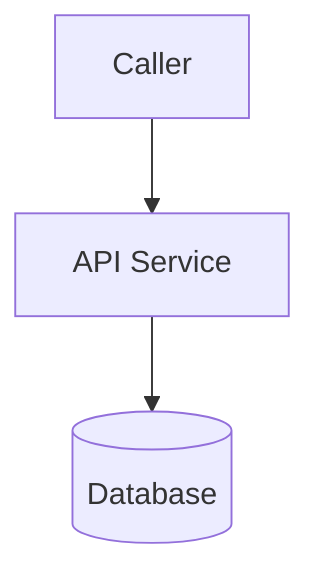

| Property | Value |
| :--- | :--- |
| Endpoints | 8 |
| Base path | `https://platform.nlproducts.net/o` |

## Architecture

## Endpoints

### DELETE `/language/v1.0/messages`

[Message] Language.v1.0.deleteMessage

### GET `/language/v1.0/messages`

[Message] Language.v1.0.getMessage

### POST `/language/v1.0/messages`

[Message] Language.v1.0.postMessage

### PUT `/language/v1.0/messages`

[Message] Language.v1.0.putMessage

### DELETE `/language/v1.0/messages/batch`

[Message] Language.v1.0.deleteMessageBatch

### POST `/language/v1.0/messages/batch`

[Message] Language.v1.0.postMessageBatch

### PUT `/language/v1.0/messages/batch`

[Message] Language.v1.0.putMessageBatch

### POST `/language/v1.0/messages/import`

[Message] Language.v1.0.postMessageImport
