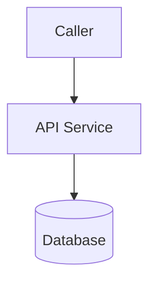

| Property | Value |
| :--- | :--- |
| Endpoints | 10 |
| Base path | `https://platform.nlproducts.net/o` |

## Architecture

## Endpoints

### POST `/nl-account-relationship/v1.0/account-relationships`

[AccountRelationship] NlAccountRelationship.v1.0.postAccountRelationship

### DELETE `/nl-account-relationship/v1.0/account-relationships/batch`

[AccountRelationship] NlAccountRelationship.v1.0.deleteAccountRelationshipBatch

### POST `/nl-account-relationship/v1.0/account-relationships/batch`

[AccountRelationship] NlAccountRelationship.v1.0.postAccountRelationshipBatch

### PUT `/nl-account-relationship/v1.0/account-relationships/batch`

[AccountRelationship] NlAccountRelationship.v1.0.putAccountRelationshipBatch

### GET `/nl-account-relationship/v1.0/account-relationships/enriched`

[AccountRelationship] NlAccountRelationship.v1.0.getEnrichedAccountRelationships

### POST `/nl-account-relationship/v1.0/account-relationships/existence`

[AccountRelationship] NlAccountRelationship.v1.0.postAccountRelationshipExistence

### POST `/nl-account-relationship/v1.0/account-relationships/search`

[AccountRelationship] NlAccountRelationship.v1.0.postAccountRelationshipSearch

### DELETE `/nl-account-relationship/v1.0/account-relationships/{accountRelationshipId}`

[AccountRelationship] NlAccountRelationship.v1.0.deleteAccountRelationship

### GET `/nl-account-relationship/v1.0/account-relationships/{accountRelationshipId}`

[AccountRelationship] NlAccountRelationship.v1.0.getAccountRelationship

### PUT `/nl-account-relationship/v1.0/account-relationships/{accountRelationshipId}`

[AccountRelationship] NlAccountRelationship.v1.0.putAccountRelationship
