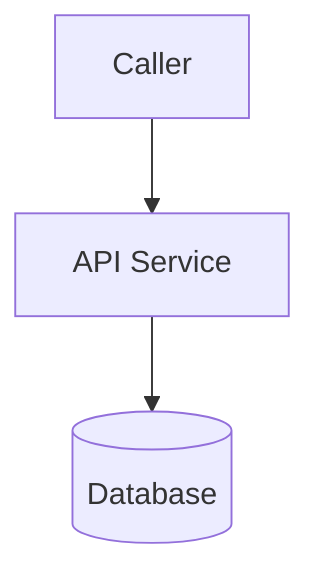

| Property | Value |
| :--- | :--- |
| Endpoints | 13 |
| Base path | `https://platform.nlproducts.net/o` |

## Architecture

## Endpoints

### GET `/nl-asset-display-page-resolver/v1.0/api/sites/{siteId}/asset-display-page`

[AssetDisplayPage] NlAssetDisplayPageResolver.v1.0.getAssetDisplayPage

### POST `/nl-asset-display-page-resolver/v1.0/api/sites/{siteId}/asset-display-page`

[AssetDisplayPage] NlAssetDisplayPageResolver.v1.0.setAssetDisplayPage

### POST `/nl-asset-display-page-resolver/v1.0/api/sites/{siteId}/asset-display-page/batch`

[AssetDisplayPage] NlAssetDisplayPageResolver.v1.0.batchSetAssetDisplayPage

### GET `/nl-asset-display-page-resolver/v1.0/api/sites/{siteId}/asset-friendly-url`

[AssetFriendlyURL] NlAssetDisplayPageResolver.v1.0.getAssetFriendlyURLs

### POST `/nl-asset-display-page-resolver/v1.0/api/sites/{siteId}/asset-friendly-url`

[AssetFriendlyURL] NlAssetDisplayPageResolver.v1.0.setAssetFriendlyURL

### POST `/nl-asset-display-page-resolver/v1.0/api/sites/{siteId}/asset-info/batch-get`

[AssetInfo] NlAssetDisplayPageResolver.v1.0.batchGetAssetInfo

### POST `/nl-asset-display-page-resolver/v1.0/api/sites/{siteId}/asset-info/batch-set`

[AssetInfo] NlAssetDisplayPageResolver.v1.0.batchSetAssetInfo

### GET `/nl-asset-display-page-resolver/v1.0/api/sites/{siteId}/display-page-templates`

[DisplayPageTemplate] NlAssetDisplayPageResolver.v1.0.getDisplayPageTemplates

### PATCH `/nl-asset-display-page-resolver/v1.0/api/sites/{siteId}/display-page-templates/by-plid/{plid}/friendly-url`

[DisplayPageTemplate] NlAssetDisplayPageResolver.v1.0.updateDisplayPageTemplateFriendlyUrlByPlid

### GET `/nl-asset-display-page-resolver/v1.0/api/sites/{siteId}/display-page-templates/{templateId}`

[DisplayPageTemplate] NlAssetDisplayPageResolver.v1.0.getDisplayPageTemplate

### PATCH `/nl-asset-display-page-resolver/v1.0/api/sites/{siteId}/display-page-templates/{templateId}/friendly-url`

[DisplayPageTemplate] NlAssetDisplayPageResolver.v1.0.updateDisplayPageTemplateFriendlyUrlByTemplateId

### GET `/nl-asset-display-page-resolver/v1.0/api/companies/{companyId}/friendly-url-separators`

[FriendlyURLSeparator] NlAssetDisplayPageResolver.v1.0.getFriendlyURLSeparators

### POST `/nl-asset-display-page-resolver/v1.0/api/companies/{companyId}/friendly-url-separators`

[FriendlyURLSeparator] NlAssetDisplayPageResolver.v1.0.updateFriendlyURLSeparator
