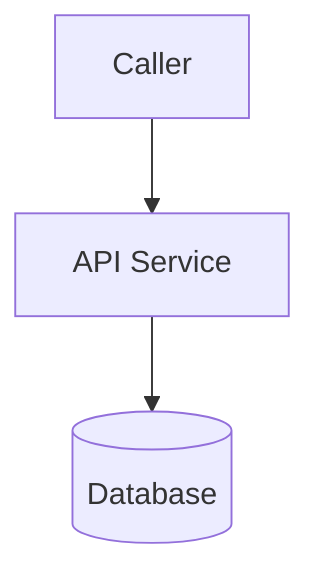

| Property | Value |
| :--- | :--- |
| Endpoints | 5 |
| Base path | `https://platform.nlproducts.net/o` |

## Architecture

## Endpoints

### GET `/nl-aws-route53-rest/v1.0/dns-records`

[DnsRecord] NlAwsRoute53Rest.v1.0.getDnsRecords

### POST `/nl-aws-route53-rest/v1.0/dns-records`

[DnsRecord] NlAwsRoute53Rest.v1.0.createDnsRecord

### POST `/nl-aws-route53-rest/v1.0/dns-records/sync`

[DnsRecord] NlAwsRoute53Rest.v1.0.syncDomains

### DELETE `/nl-aws-route53-rest/v1.0/dns-records/{domainName}`

[DnsRecord] NlAwsRoute53Rest.v1.0.deleteDnsRecord

### DELETE `/nl-aws-route53-rest/v1.0/dns-records/{domainName}/batch`

[DnsRecord] NlAwsRoute53Rest.v1.0.deleteDnsRecordBatch
