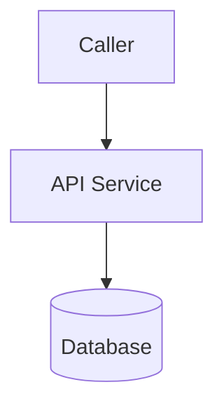

| Property | Value |
| :--- | :--- |
| Endpoints | 11 |
| Base path | `https://platform.nlproducts.net/o` |

## Architecture

## Endpoints

### POST `/nl-contact/v1.0/contacts`

[Contact] NlContact.v1.0.postContact

### POST `/nl-contact/v1.0/contacts/batch`

[Contact] NlContact.v1.0.postContactBatch

### GET `/nl-contact/v1.0/contacts/by-upstream-contact-id/{upstreamContactId}`

[Contact] NlContact.v1.0.getContactByUpstreamContactId

### GET `/nl-contact/v1.0/contacts/enriched`

[Contact] NlContact.v1.0.getEnrichedContacts

### POST `/nl-contact/v1.0/contacts/existence`

[Contact] NlContact.v1.0.postContactExistence

### POST `/nl-contact/v1.0/contacts/search`

[Contact] NlContact.v1.0.postContactSearch

### DELETE `/nl-contact/v1.0/contacts/{contactEntryId}`

[Contact] NlContact.v1.0.deleteContact

### GET `/nl-contact/v1.0/contacts/{contactEntryId}`

[Contact] NlContact.v1.0.getContact

### PUT `/nl-contact/v1.0/contacts/{contactEntryId}`

[Contact] NlContact.v1.0.putContact

### DELETE `/nl-contact/v1.0/contacts/{contactEntryId}/batch`

[Contact] NlContact.v1.0.deleteContactBatch

### PUT `/nl-contact/v1.0/contacts/{contactEntryId}/batch`

[Contact] NlContact.v1.0.putContactBatch
