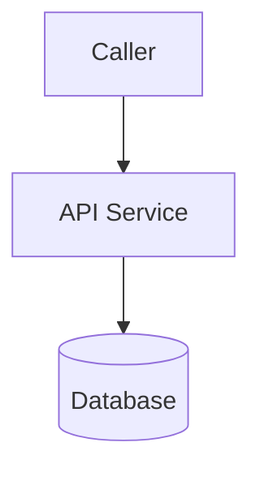

| Property | Value |
| :--- | :--- |
| Endpoints | 15 |
| Base path | `https://platform.nlproducts.net/o` |

## Architecture

## Endpoints

### GET `/nl-data-headless/v1.0/filters`

[Filters] NlDataHeadless.v1.0.getFilters

### GET `/nl-data-headless/v1.0/filters/{filterId}`

[Filters] NlDataHeadless.v1.0.getFilter

### GET `/nl-data-headless/v1.0/grid-definitions/{gridKey}`

[GridMetadata] NlDataHeadless.v1.0.getGridDefinition

### GET `/nl-data-headless/v1.0/grids`

[GridMetadata] NlDataHeadless.v1.0.getGrids

### GET `/nl-data-headless/v1.0/grids/{gridKey}/preferences`

[GridMetadata] NlDataHeadless.v1.0.getGridPreferences

### PUT `/nl-data-headless/v1.0/grids/{gridKey}/preferences`

[GridMetadata] NlDataHeadless.v1.0.putGridPreferences

### DELETE `/nl-data-headless/v1.0/grids/{gridKey}/preferences/reset`

[GridMetadata] NlDataHeadless.v1.0.resetGridPreferences

### POST `/nl-data-headless/v1.0/filters`

[SavedFilter] NlDataHeadless.v1.0.createFilter

### DELETE `/nl-data-headless/v1.0/filters/{filterId}`

[SavedFilter] NlDataHeadless.v1.0.deleteFilter

### PUT `/nl-data-headless/v1.0/filters/{filterId}`

[SavedFilter] NlDataHeadless.v1.0.updateSharedFilter

### POST `/nl-data-headless/v1.0/filters/share`

[SharedFilter] NlDataHeadless.v1.0.shareFilter

### POST `/nl-data-headless/v1.0/filters/share/delete`

[SharedFilter] NlDataHeadless.v1.0.unshareFilters

### GET `/nl-data-headless/v1.0/filters/share/saved-filter/{savedFilterId}/info`

[SharedFilter] NlDataHeadless.v1.0.getFilterShareInfo

### GET `/nl-data-headless/v1.0/filters/share/users`

[SharedFilter] NlDataHeadless.v1.0.getShareableUsers

### DELETE `/nl-data-headless/v1.0/filters/share/{filterShareId}`

[SharedFilter] NlDataHeadless.v1.0.unshareFilter
