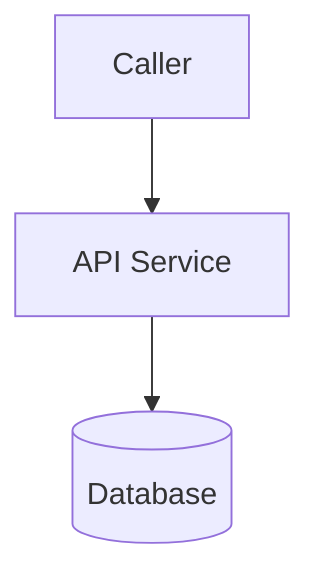

| Property | Value |
| :--- | :--- |
| Endpoints | 4 |
| Base path | `https://platform.nlproducts.net/o` |

## Architecture

## Endpoints

### POST `/nl-govcon-export-rest-service/v1.0/govcon/export`

[Export] NlGovconExportRestService.v1.0.export

### GET `/nl-govcon-export-rest-service/v1.0/govcon/export/files`

[Export] NlGovconExportRestService.v1.0.getExportFiles

### DELETE `/nl-govcon-export-rest-service/v1.0/govcon/export/files/{exportId}`

[Export] NlGovconExportRestService.v1.0.deleteExportFile

### POST `/nl-govcon-export-rest-service/v1.0/govcon/export/tasks/{exportId}/stop`

[Export] NlGovconExportRestService.v1.0.stopExportTask
