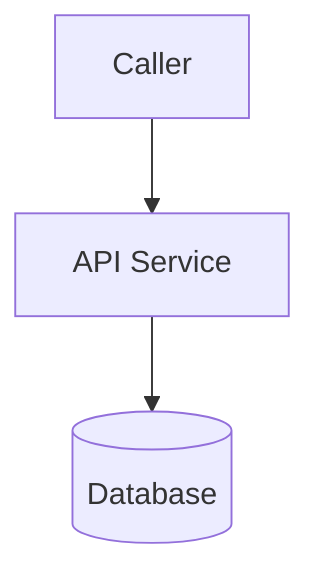

| Property | Value |
| :--- | :--- |
| Endpoints | 8 |
| Base path | `https://platform.nlproducts.net/o` |

## Architecture

## Endpoints

### GET `/nl-govcon-grid-rest-service/v1.0/getFragment`

[FragmentDetails] NlGovconGridRestService.v1.0.getFragmentByName

### POST `/nl-govcon-grid-rest-service/v1.0/fetchGridColumnsConfiguration`

[GridManagement] NlGovconGridRestService.v1.0.fetchGridColumnsConfiguration

### POST `/nl-govcon-grid-rest-service/v1.0/fetchObjectEntries`

[GridManagement] NlGovconGridRestService.v1.0.fetchObjectEntries

### POST `/nl-govcon-grid-rest-service/v1.0/fetchRecommendedFilters`

[GridManagement] NlGovconGridRestService.v1.0.fetchRecommendedFilters

### POST `/nl-govcon-grid-rest-service/v1.0/fetchSavedFilter`

[GridManagement] NlGovconGridRestService.v1.0.fetchSavedFilter

### POST `/nl-govcon-grid-rest-service/v1.0/fetchSharedFilter`

[GridManagement] NlGovconGridRestService.v1.0.fetchSharedFilter

### GET `/nl-govcon-grid-rest-service/v1.0/get-picklist-data`

[GridManagement] NlGovconGridRestService.v1.0.getPickListData

### POST `/nl-govcon-grid-rest-service/v1.0/saveFilter`

[GridManagement] NlGovconGridRestService.v1.0.saveFilter
